[English](README.md) · [日本語](README.ja.md) · [Español](README.es.md) · [Français](README.fr.md) · [简体中文](README.zh-CN.md)

# Worktree Kanban

> Lancez des agents de code IA en parallèle et pilotez-les depuis un autre PC : Mac et Windows peuvent se contrôler mutuellement à distance.

[Site web](https://kazuya83.github.io/worktree-kanban/)

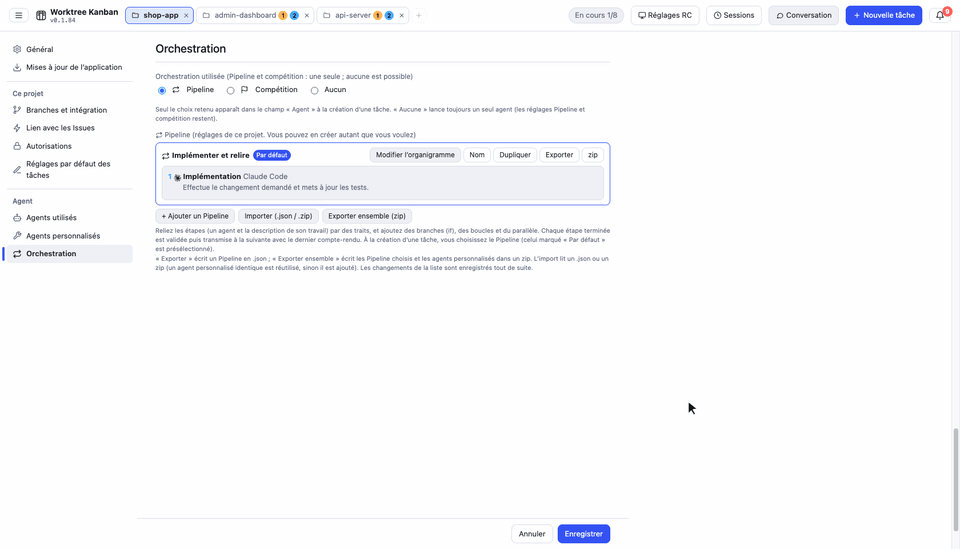

Application de bureau (Electron, Mac / Windows / Linux) qui lance en parallèle les CLI d'agents de code IA (Claude Code / Codex CLI / Gemini CLI / Cursor CLI), chaque tâche dans son propre git worktree, et les suit sur un tableau kanban. **Elle ne se limite pas à un seul dépôt : elle peut aussi faire avancer en même temps des tâches de plusieurs dépôts.**

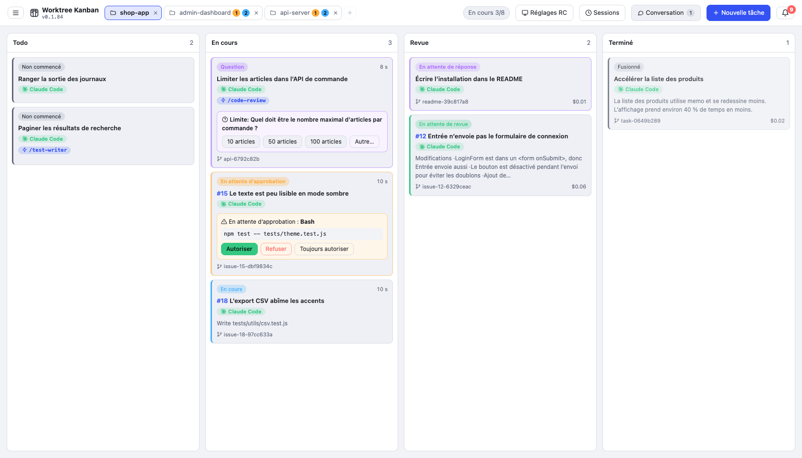

## Fonctionnement

- **1 tâche = 1 worktree = 1 branche.** Elle crée un worktree dans `<repo>.worktrees/<id>`, à côté du dépôt, et travaille sur une branche `agent/<résumé>-<id>`. Les tâches ne se gênent pas entre elles, ni avec l'arbre de travail que vous avez ouvert
- **L'agent est la CLI, lancée telle quelle.** Claude Code s'exécute avec `claude -p --input-format stream-json --output-format stream-json`, et sa sortie s'affiche sur la carte comme journal. La connexion, le modèle, `CLAUDE.md` et les skills sont ceux que vous utilisez dans le terminal
- **L'approbation passe par `--permission-prompt-tool` de Claude Code.** Seules les actions que le mode de permission ou `--allowedTools` n'autorise pas tout seul apparaissent sur la carte comme attente d'approbation
- **Une fois terminé, vous intégrez le travail par un merge (`--no-ff`) ou en ouvrant un PR (`gh`).** Vous choisissez la branche cible, et vous pouvez pousser vers origin après le merge
- L'état du tableau est enregistré dans `board.json`, dans le dossier userData d'Electron. Il n'y a pas de serveur externe

Avec Codex / Gemini / Cursor, à cause des limites de la CLI, l'approbation sur la carte, les questions à choix, btw et l'affichage du coût ne sont pas disponibles (détails dans [docs/agents.md](docs/agents.md) (Japanese)).

## Fonctions principales

### Piloter depuis un autre PC (RC)

Vous pouvez piloter le tableau du PC qui fait tourner les agents (l'hôte) depuis Worktree Kanban sur un autre PC (le client). Mac ou Windows peuvent être l'hôte, et l'un ou l'autre peut être le client. Sur le client, vous approuvez, répondez aux questions, envoyez des instructions supplémentaires, mergez, etc., comme sur l'écran de l'hôte.

- L'application hôte n'écoute que sur `127.0.0.1`. L'application cliente se connecte avec un tunnel `ssh -N -L` : l'hôte n'a donc besoin que d'un serveur SSH. Pour vous connecter depuis l'extérieur, utilisez Tailscale ou un réseau du même genre
- SSH se connecte avec une clé. Dans les « Réglages RC » du client, créez une clé ed25519 (`~/.ssh/agent-kanban_ed25519`) et enregistrez la clé publique dans les « Réglages RC » de l'hôte
- La première fois, l'appairage se fait avec un code à 6 chiffres affiché sur l'hôte. Ensuite, un jeton enregistré reconnecte la destination précédente

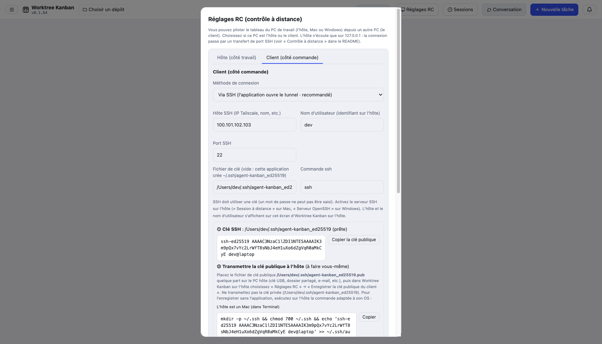

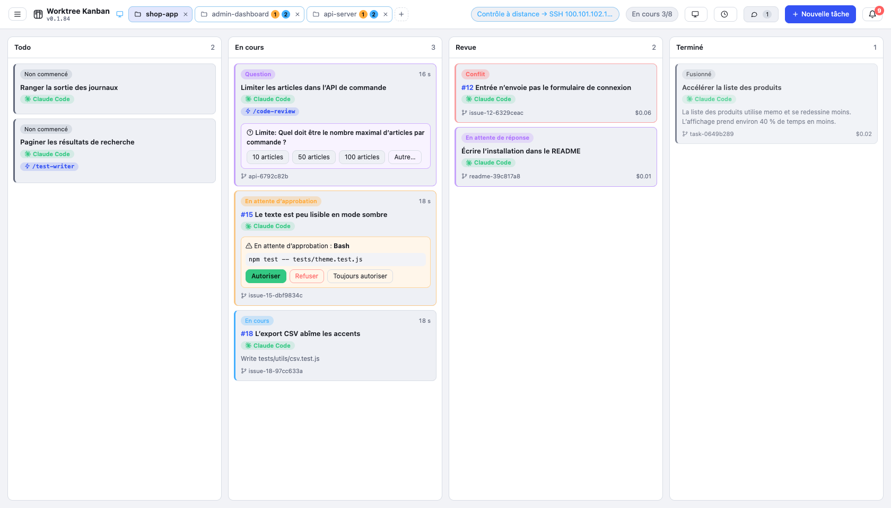

La procédure, et comment réparer une connexion qui échoue, se trouve dans [docs/remote.md](docs/remote.md) (Japanese).

Également : découper une grande tâche en sous-tâches qui avancent en parallèle ou dans l'ordre (elles partent de la branche parente et y sont fusionnées une fois terminées ; une seule sous-tâche peut aussi être démarrée ; les sous-issues GitHub sont prises en charge), changer l'état (colonne) d'une carte par glisser-déposer, messages à un agent en cours d'exécution (btw), pièces jointes image et fichier, Pipeline et compétition (combinaisons de plusieurs agents), et dépôts WSL sous Windows. L'utilisation est résumée dans [docs/usage.md](docs/usage.md) (Japanese).

### Lancer plusieurs dépôts en parallèle

Les dépôts s'ouvrent en onglets (3 au plus). Changer d'onglet n'arrête pas les tâches des autres dépôts. Un onglet qui n'est pas sélectionné affiche **combien de tâches tournent** (bleu) et **combien attendent une action de votre part** (approbation, question, etc., en orange) : les onglets suffisent pour voir quel dépôt a besoin de vous. La limite du nombre de tâches lancées en même temps (le réglage correspondant) est partagée par tous les dépôts.

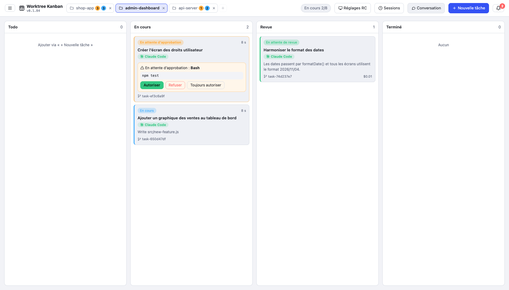

Le « + » de la barre d'onglets, ou un clic sur l'onglet ouvert, permet de choisir parmi les dépôts ouverts récemment. Vous pouvez aussi cloner depuis une URL ou créer un nouveau dépôt depuis là.

Vous pouvez ouvrir un dossier qui n'est pas un dépôt git (production vidéo et autre travail qui n'est pas du code). La tâche s'exécute alors directement dans le dossier, sans worktree, et vous la terminez avec « Marquer comme terminée » (détails dans [docs/usage.md](docs/usage.md) (Japanese)).

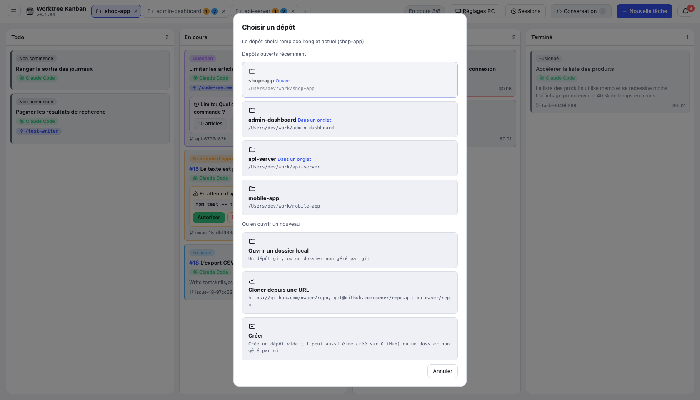

### Approbation

Quand une action a besoin d'une permission, vous lisez la commande et l'entrée en entier sur la carte et dans le panneau de détail, puis vous choisissez autoriser, refuser, ou toujours autoriser pour cette tâche. En cas de refus, vous pouvez renvoyer une raison à l'agent.

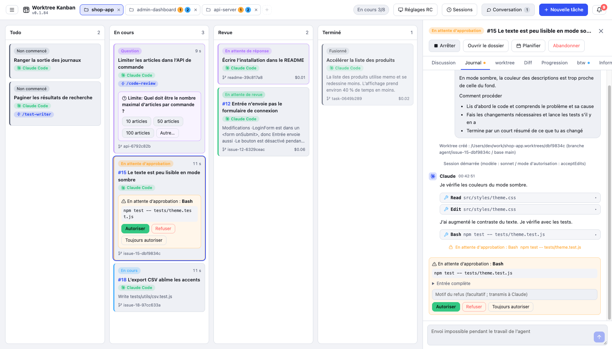

### Créer des tâches depuis des GitHub Issues

Dans l'onglet « Créer depuis une GitHub Issue » de « Nouvelle tâche », saisissez des numéros (`21, 22, 24`, etc.). Les instructions sont construites à partir du titre, du corps et des commentaires de l'Issue, et une carte est créée par Issue. La branche s'appelle `agent/issue-21-…`, et le corps du PR contient `Closes #21`. Cela utilise `gh`.

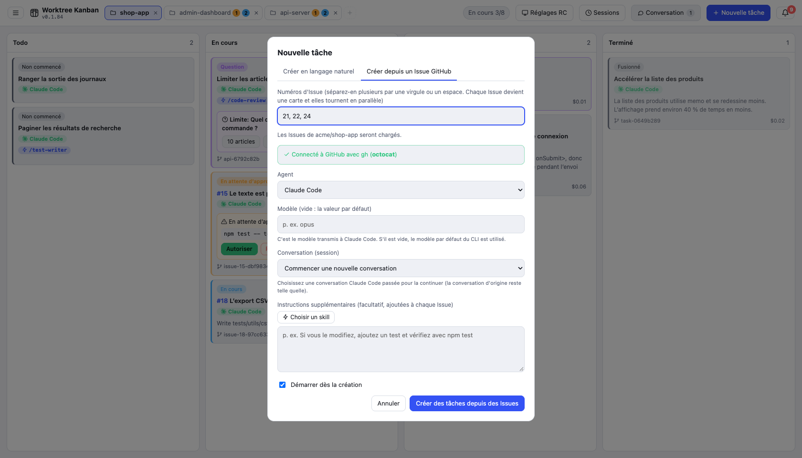

### Questions de l'agent

Quand Claude Code pose une question avec `AskUserQuestion`, la carte devient une question et un formulaire de réponse s'affiche. Le choix multiple et le texte libre (Autre) sont pris en charge.

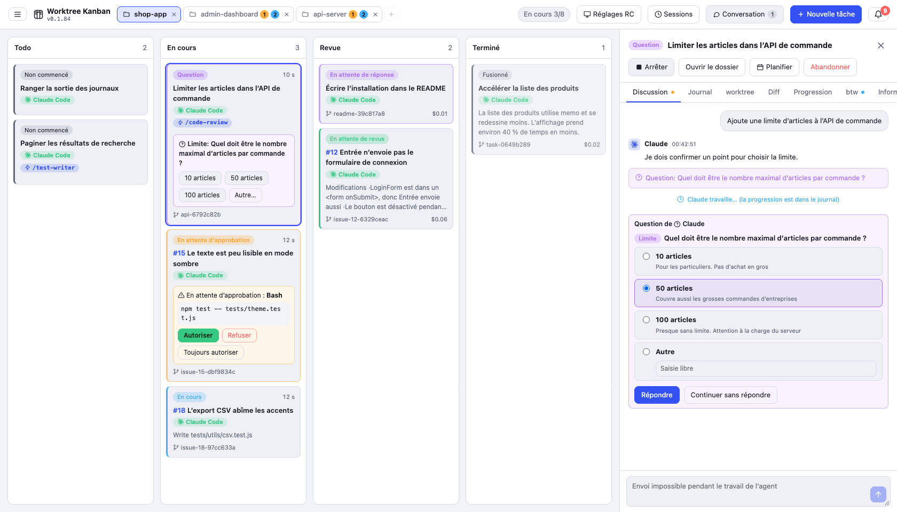

### worktree et diff

L'onglet « worktree » montre les commits de la branche, les changements non commités, le rapport avec la base, et les autres worktrees du même dépôt. Dans l'onglet « diff », vous choisissez les fichiers modifiés dans un arbre groupé par dossier et vous lisez le diff fichier par fichier.

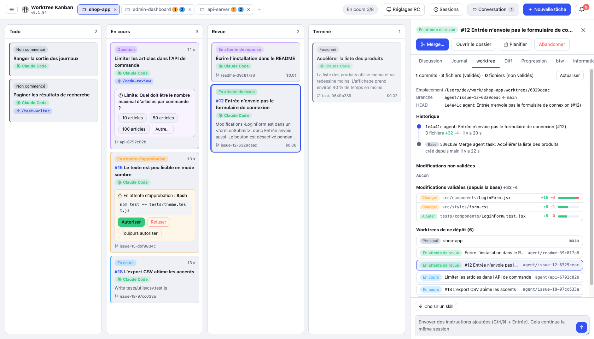

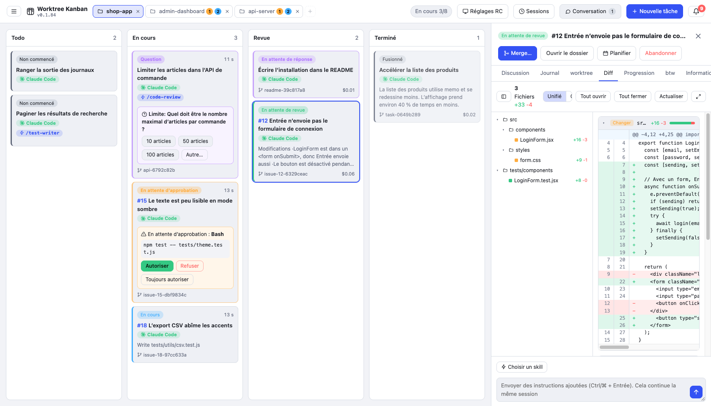

### Conversation

Dans « Conversation », vous pouvez interroger l'agent sur le dépôt sans créer de tâche (worktree). Les réponses s'affichent en Markdown. Quand vous voulez qu'il se mette au travail, « En faire une tâche » poursuit cette conversation comme une tâche.

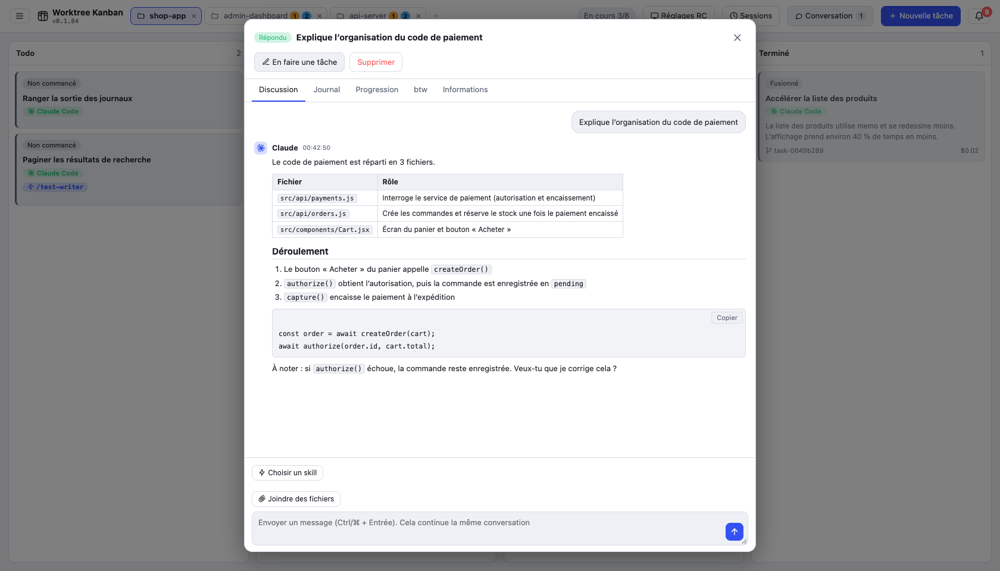

### Notifications

L'attente d'approbation, les questions, l'attente d'une réponse, l'attente de revue et la fin de tâche s'accumulent sur l'icône de cloche en haut à droite, et une notification de bureau s'affiche aussi. Un clic sur une notification ouvre cette tâche.

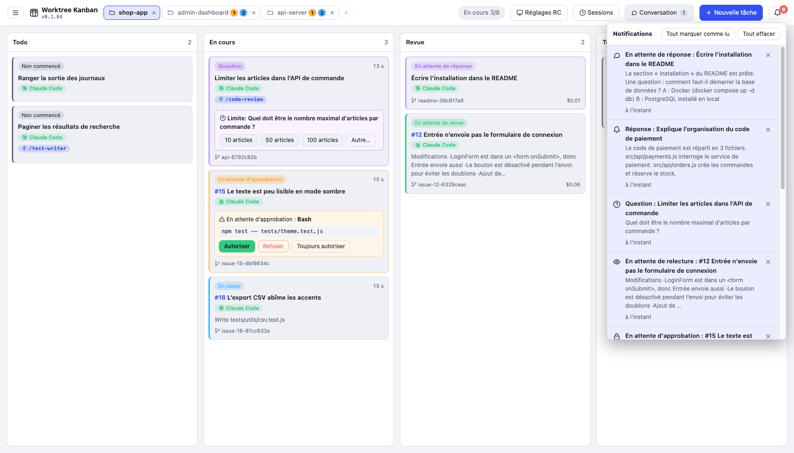

### Résoudre les conflits

Si un merge entre en conflit, la carte devient un conflit. Une fois la branche de base intégrée dans la branche de la tâche, vous pouvez faire résoudre le conflit par l'agent ou le corriger vous-même dans un éditeur. Dans les deux cas, la branche de base ne change pas tant que vous n'avez pas mergé.

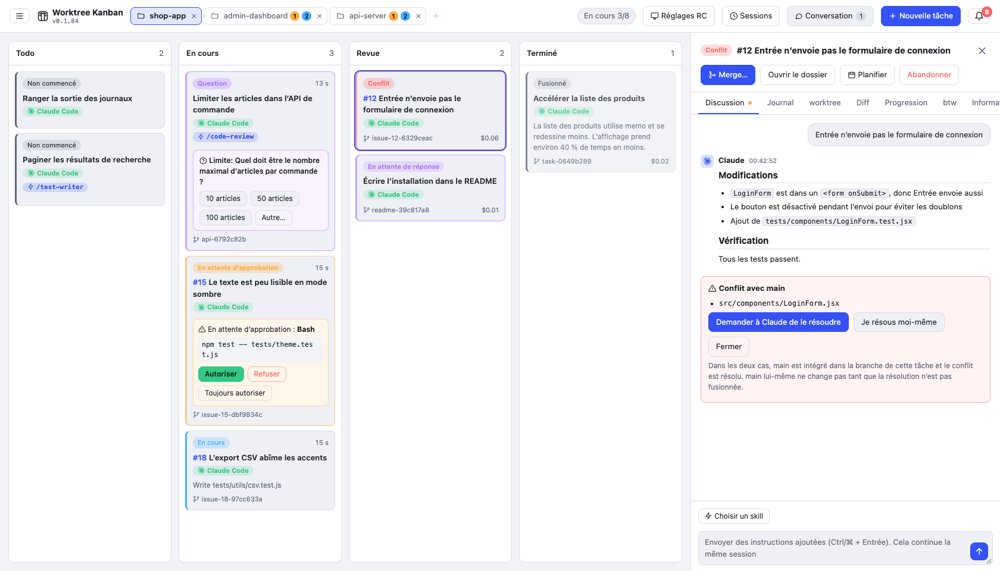

### Skills et conversations passées

À la création d'une tâche, vous pouvez choisir une skill de Claude Code (elle est passée comme `/nom-de-la-skill`). Vous pouvez aussi choisir une conversation passée de Claude Code (session) et reprendre là où elle s'était arrêtée.

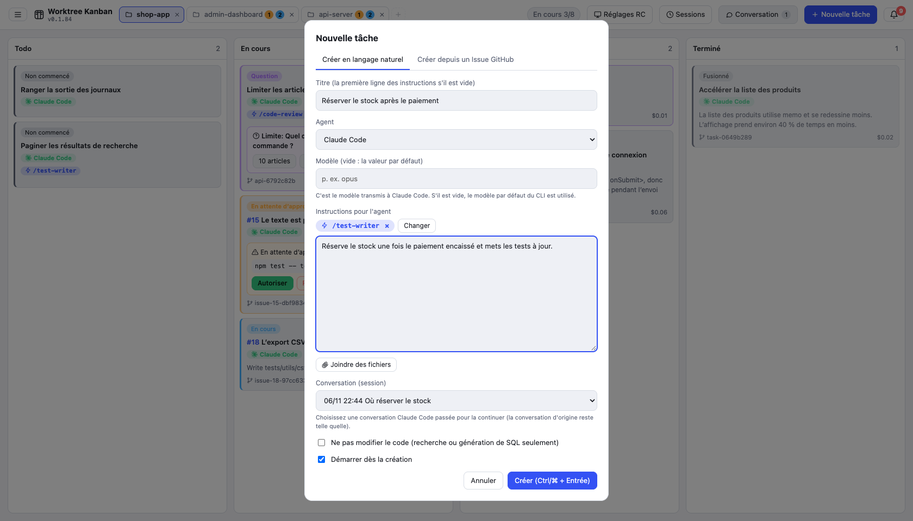

### Planificateur de tâches

Depuis le menu de la barre du haut, passez au « Planificateur de tâches » pour gérer, sous forme de cartes, des planifications qui créent et lancent une tâche à une date donnée (une fois, toutes les heures, tous les jours, toutes les semaines ou tous les mois). Vous pouvez enregistrer une tâche du kanban comme planification, et créer tout de suite une tâche à partir d'une planification. Les planifications ne tournent que tant que l'application est ouverte (détails dans [docs/usage.md](docs/usage.md) (Japanese)).

## Prérequis

- git
- La CLI de l'agent que vous utilisez (l'un de Claude Code / Codex CLI / Gemini CLI / Cursor CLI), déjà connectée
- `gh`, si vous utilisez les Issues et les PR GitHub (vous pouvez aussi l'installer depuis l'application)

## Installation

**Mac / Linux**

```bash
curl -fsSL https://raw.githubusercontent.com/kazuya83/worktree-kanban/main/install.sh | bash
```

**Windows** (PowerShell)

```powershell
irm https://raw.githubusercontent.com/kazuya83/worktree-kanban/main/install.ps1 | iex
```

Les mêmes commandes mettent à jour vers la dernière version. Vous pouvez aussi mettre à jour depuis l'application : « Réglages » → « Mise à jour de l'application » → « Mettre à jour vers la nouvelle version ». Si vous cochez « Mettre à jour automatiquement quand une nouvelle version sort », elle se remplace et se relance lorsqu'aucune tâche ne tourne. Pour choisir une version, désinstaller, installer depuis un fichier et l'avertissement du premier lancement, voir [docs/install.md](docs/install.md) (Japanese).

## Utilisation

1. Dans « Choisir un dépôt », choisissez le dépôt git sur lequel travailler (vous pouvez aussi cloner depuis une URL ou en créer un nouveau)
2. Dans « Nouvelle tâche », écrivez les instructions et créez-la
3. Quand elle attend une approbation, autorisez-la sur la carte
4. Quand elle passe dans la colonne Revue, vérifiez le diff et appuyez sur « Merge » ou « Créer un PR »

## Documentation

| Document | Contenu |
| --- | --- |
| [Écran et utilisation](docs/usage.md) (Japanese) | Utilisation de chaque fonction : approbation, questions, vérification de la spécification, planificateur de tâches, skills, conversation, btw, merge / PR, état des Issues, notifications, conflits, et le reste |
| [Agents et orchestration](docs/agents.md) (Japanese) | Différences entre Claude Code / Codex / Gemini / Cursor, Pipeline et compétition |
| [Réglages](docs/settings.md) (Japanese) | L'écran des réglages ouvert depuis le menu de la barre du haut, et ses rubriques |
| [Contrôle à distance](docs/remote.md) (Japanese) | Comment piloter le tableau depuis un autre PC par un tunnel SSH, et comment réparer une connexion qui échoue |
| [Installation](docs/install.md) (Japanese) | Installation, mise à jour, désinstallation, et utilisation d'un dépôt WSL sous Windows |
| [Pour les développeurs](docs/development.md) (Japanese) | Lancer depuis les sources, compiler, publier, comment l'application est faite, et les tests |

## Licence

Publié sous [Functional Source License 1.1 (FSL-1.1-ALv2)](LICENSE). Vous pouvez l'utiliser, le modifier et le redistribuer à toute fin, sauf pour un produit ou service commercial concurrent. Chaque version devient disponible sous Apache License 2.0 deux ans après sa publication.
