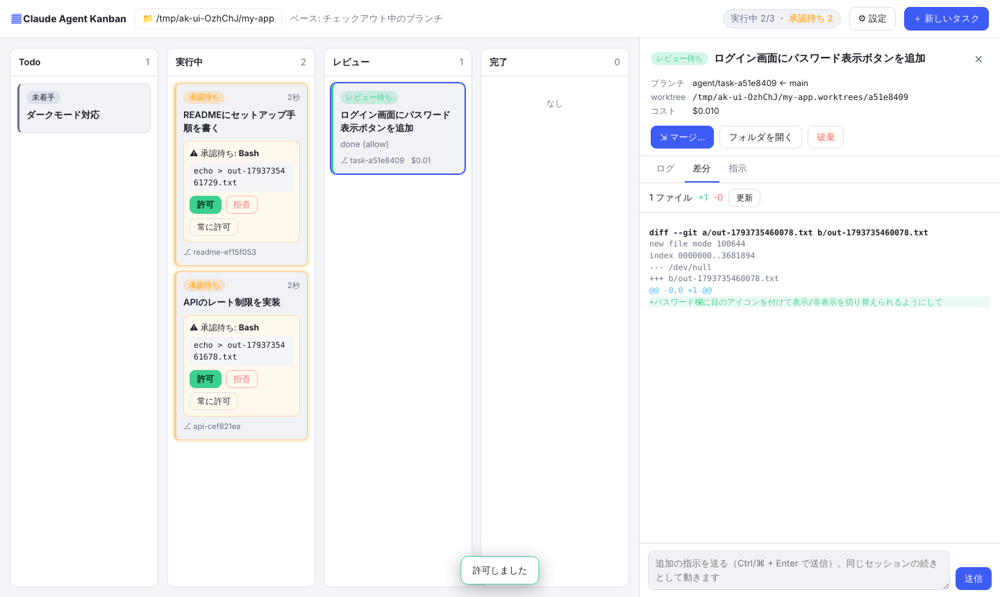
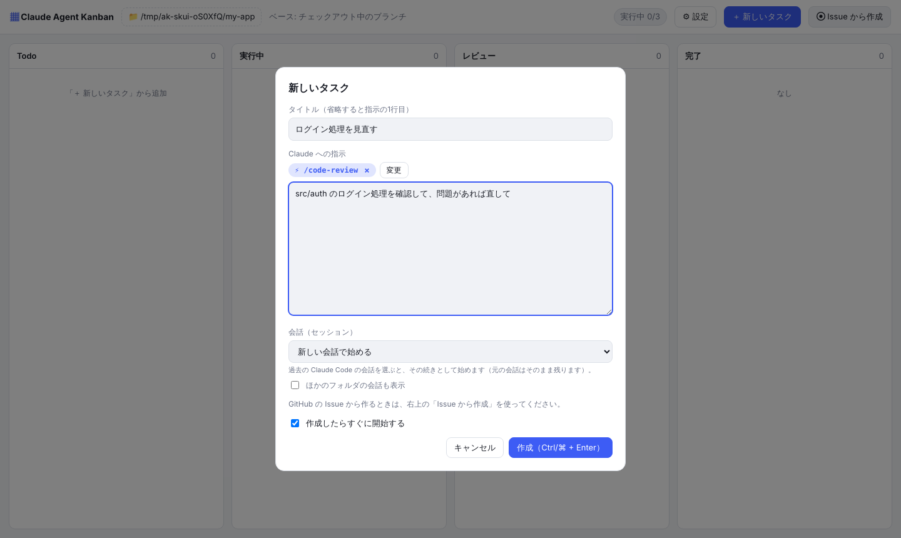
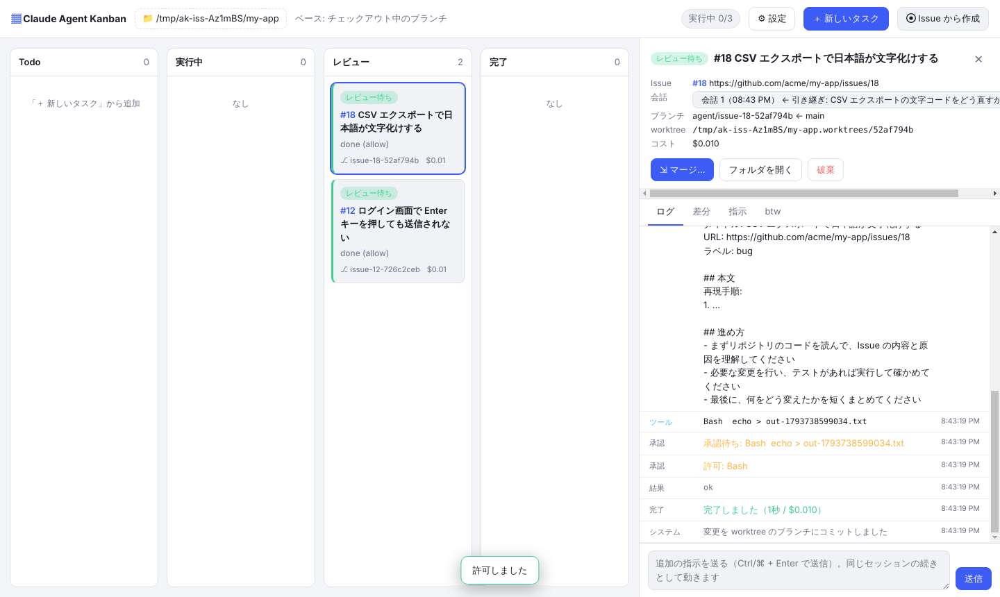

# Claude Agent Kanban

Claude Code のタスクをカンバンボードで管理するデスクトップアプリ（Electron）です。タスクごとに **git worktree** を作り、複数のエージェントを **並列** に動かします。許可が必要な操作は **カード上でそのまま承認** できます。


## 画面

### カード上で承認する
承認待ちのカードは黄色く光ります。実行しようとしているコマンドを確かめて、その場で「許可 / 拒否 / 常に許可」を押せます。

### 詳細パネル（承認待ち）
カードをクリックすると開きます。入力の全文を確かめたり、拒否の理由を書いて Claude に伝えたりできます。ログはリアルタイムに流れます。


### 詳細パネル（差分・マージ）
レビュー列のカードでは、ベースブランチからの差分を見てからマージできます。マージ先は、好きなブランチを選べます（新しく作ることもできます）。



### スキルを選ぶ
「⚡ スキルを選ぶ」を押すと、使えるスキルがカードで並びます。1つだけ選べます。選んだスキルは、入力欄の上にラベルで出ます。




### Issue から作成
「Issue から作成」を押して、Issue 番号と会話（セッション）を選びます。複数の番号を入れると、それぞれ1枚のカードになって並列で動きます。


### 会話（セッション）を切り替える
詳細画面の「会話」で、次の実行にどの会話を使うかを選べます。既存の会話から引き継いだときは、どこから引き継いだかが表示されます。



### btw（実行中にメッセージを送る）
実行中のカードの「btw」タブから、作業を止めずに Claude へメッセージを送れます。受け取られると「反映済み」になります。


### マージ先を選ぶ
「マージ…」を押すと、マージ先のブランチを選べます。新しいブランチを作ったり、マージしたあともタスクを続けたりもできます。


## できること

- **カードを作るとすぐに動き出す**: ブランチ `agent/<名前>-<id>` と worktree（`<リポジトリ>.worktrees/<id>`）を自動で作り、その中で `claude -p` を起動します
- **GitHub Issue からタスクを作る**: 「＋ 新しいタスク」の右にある「Issue から作成」を押して、番号を入れるだけで、Issue のタイトル・本文・ラベル・コメントから Claude への指示を作ります。`12, 15, 18` のように複数入れると、1つの Issue が1枚のカードになって並列で動きます
  - ブランチは `agent/issue-12-…`、コミットメッセージには `(#12)` が付きます。カードの `#12` を押すと Issue のページが開きます
  - 同じ画面で、会話（セッション）と追加の指示も選べます
  - Issue は **gh（GitHub CLI）** で読み込みます。gh が入っていなければ、同じ画面の「gh をインストールする」から入れられます（Mac は Homebrew、Windows は winget）。ログインしていなければ「GitHub にログイン」を押すと、ブラウザが開いて確認コードが表示されるので、それを入力するだけです
  - public リポジトリなら、gh がなくても読み込めます
- **スキルを選ぶ**: タスクを作るとき（手で書く / Issue から）と、詳細画面で追加指示を送るときに、Claude Code のスキルを1つ選べます。スキルはカードの一覧から選び、選んだスキルは入力欄の上にラベルで表示されます（× で外せます）
  - 選んだスキルは、指示の先頭に `/スキル名` として付けて Claude に渡します
  - 一覧には、このリポジトリの `.claude/skills/`、自分用の `~/.claude/skills/`、インストール済みのプラグインのスキルが出ます
  - ⚙ 設定で「新しいタスクで最初から選んでおくスキル」を決めておけます
- **会話（セッション）を選ぶ**: タスクを作るときに、過去の Claude Code の会話（ターミナルで話していたものなど）を選ぶと、その続きとしてタスクを始めます。元の会話はそのまま残ります（`--fork-session`）
  - 詳細画面の「会話」で、次の追加指示を「今の会話の続き」「新しい会話」「このカードの前の会話」「ほかの既存の会話」のどれで動かすか切り替えられます
- **btw（実行中にメッセージを送る）**: 詳細パネルの「btw」タブから、エージェントの作業を止めずにメッセージを送れます（例:「テストも書いて」「その API は使わないで」）。Claude は作業の途中で読んで反映し、受け取ったら「反映済み」になります。待機中のタスクに送ると、開始するときの指示に付け足します
- **列は自動で移動**: Todo → 実行中（待機中を含む）→ レビュー（エラーを含む）→ 完了
- **カード上で承認**: 許可が必要な操作は、カードに「承認待ち」として表示されます。その場で **許可 / 拒否 / このタスクでは常に許可** を選べます。デスクトップ通知も出ます
- **詳細パネル**: カードをクリックすると開きます。中身は次のとおりです
  - ログ: Claude の発言、ツールの呼び出しと結果がリアルタイムに流れます
  - 差分: ベースブランチからの git diff
  - 指示: 最初の指示（開始前なら編集できます）
  - 追加指示: 同じセッションの続きとして動きます（`--resume`）
- **マージ / 破棄**: 好きなブランチにマージ（`--no-ff`）するか、worktree とブランチをまとめて削除します
  - マージ先は一覧から選ぶか、その場で新しいブランチを作れます（初期値はベースブランチ）
  - マージ先をどこにもチェックアウトしていなければ、一時的な worktree の中でマージするので、手元の作業フォルダは変わりません
  - 「マージ後もタスクを続ける」を選ぶと、worktree とブランチを残したままにします。たとえば `develop` に入れて確かめてから、あとで `main` にもマージできます
- **同時実行数の上限**: 上限を超えたカードは待機中になり、空きができると順番に起動します

## インストール

### コマンドでインストール（おすすめ）

**Mac / Linux**（ターミナルで実行）

```bash
curl -fsSL https://raw.githubusercontent.com/kazuya83/agent-kanban/main/install.sh | bash
```

- Mac: Apple Silicon か Intel かを見分けて、`/Applications` にインストールします。署名していないアプリで出る警告も、自動で出ないようにします
- Linux: `~/.local/bin/claude-agent-kanban` に AppImage を置き、アプリのメニューにも登録します

**Windows**（PowerShell で実行）

```powershell
irm https://raw.githubusercontent.com/kazuya83/agent-kanban/main/install.ps1 | iex
```

最新版をダウンロードして `%LOCALAPPDATA%\Programs\Claude Agent Kanban` に入れ、スタートメニューとデスクトップにショートカットを作って起動します。管理者権限はいりません。

### アップデート（最新版にする）

インストールと同じコマンドで、[Releases](https://github.com/kazuya83/agent-kanban/releases) の最新版に入れ替わります。ボードやタスクのデータはそのまま残ります。アプリを起動中なら、終了してから実行してください（Windows は自動で終了します）。

**Mac / Linux**

```bash
curl -fsSL https://raw.githubusercontent.com/kazuya83/agent-kanban/main/install.sh | bash
```

**Windows**（PowerShell）

```powershell
irm https://raw.githubusercontent.com/kazuya83/agent-kanban/main/install.ps1 | iex
```

> 直後に古い版が入るときは、GitHub 側のキャッシュ（最大5分）が残っています。少し待ってからもう一度実行してください。


<details>
<summary>バージョンを指定する・アンインストールする</summary>

```bash
curl -fsSL https://raw.githubusercontent.com/kazuya83/agent-kanban/main/install.sh | AGENT_KANBAN_VERSION=0.1.1 bash
```

```bash
curl -fsSL https://raw.githubusercontent.com/kazuya83/agent-kanban/main/install.sh | bash -s -- --uninstall
```

```powershell
$env:AGENT_KANBAN_VERSION = "0.1.1"; irm https://raw.githubusercontent.com/kazuya83/agent-kanban/main/install.ps1 | iex
```

```powershell
$env:AGENT_KANBAN_UNINSTALL = "1"; irm https://raw.githubusercontent.com/kazuya83/agent-kanban/main/install.ps1 | iex
```

（setup.exe で入れた場合は、「設定 → アプリ」から「Claude Agent Kanban」を削除します。）

</details>

### ファイルをダウンロードしてインストール

[Releases](https://github.com/kazuya83/agent-kanban/releases) から、使っている OS のファイルをダウンロードします。

| OS | ファイル | 使い方 |
| --- | --- | --- |
| Windows | `claude-agent-kanban-x.y.z-win-setup.exe` | インストーラー。ダブルクリックしてインストールします |
| Windows | `claude-agent-kanban-x.y.z-win-portable.exe` | インストールせず、そのまま起動できます |
| Windows | `claude-agent-kanban-x.y.z-win-x64.zip` | 展開して、中の `Claude Agent Kanban.exe` を起動します |
| Mac（Apple Silicon: M1〜） | `claude-agent-kanban-x.y.z-mac-arm64.dmg` | 開いて、アプリを「アプリケーション」にドラッグします |
| Mac（Intel） | `claude-agent-kanban-x.y.z-mac-x64.dmg` | 同上 |
| Linux | `claude-agent-kanban-x.y.z-linux-x86_64.AppImage` | 実行権限を付けて起動します |

> **初めて起動するときの注意**
> 開発元の証明書で署名していないので、OS の警告が出ます。
> - **Mac**: 「開発元を検証できません」と出たら、アプリを右クリックして「開く」を選びます。それでも開けないときは、ターミナルで `xattr -cr "/Applications/Claude Agent Kanban.app"` を実行してください
> - **Windows**: 「Windows によって PC が保護されました」と出たら、「詳細情報」→「実行」を押します

アプリとは別に、**git** と **Claude Code**（ログイン済み）が必要です。アプリは、ターミナルの PATH にある `claude` を自動で探します。見つからないときは、画面の上に案内が出ます（⚙ 設定でフルパスを指定することもできます）。

## ソースから動かす

### 必要なもの

- Node.js 20 以上
- git
- [Claude Code](https://docs.claude.com/en/docs/claude-code) をインストールし、ログインしておく（`claude` コマンドが使えれば OK）

### 起動

```bash
npm install
```

```bash
npm start
```

1. 「リポジトリを選ぶ」から、作業させたい git リポジトリを選びます（コミットが1つ以上必要です）
2. 「＋ 新しいタスク」から指示を書いて作成します
3. 承認待ちになったら、カードの「許可」を押します
4. レビュー列に移ったら、差分を確認して「マージ」（マージ先のブランチを選びます）か「破棄」を押します

### アプリをビルドする

```bash
npm run dist:mac
```

```bash
npm run dist:win
```

```bash
npm run dist:linux
```

`dist/` に出力されます。Mac 用は macOS 上で、Windows 用は Windows 上でビルドしてください（Linux から Windows 用をビルドするには Wine が必要です）。

GitHub Actions でも自動でビルドします（`.github/workflows/build.yml`）。
- **push したとき**: 3つの OS でビルドし、Actions の実行結果ページの「Artifacts」から、できたファイルをダウンロードできます
- **main に push したとき**: `package.json` の `version` のリリースがまだなければ、タグ（例: `v0.1.0`）と [Release](https://github.com/kazuya83/agent-kanban/releases) を自動で作り、ファイルを添付します

新しいバージョンを出すときは、`package.json` の `version` を上げて main に push するだけです。インストール用のコマンドは、いつも最新の Release を入れます。

## 設定（⚙）

| 項目 | 説明 |
| --- | --- |
| ベースブランチ | worktree の作成元。マージ先の初期値にもなります。空ならチェックアウト中のブランチ |
| 権限モード | `acceptEdits`（ファイル編集は自動、コマンドは承認）がおすすめ。`default` にすると、すべての操作をカードで承認します |
| 最初から許可しておくツール | `--allowedTools` に渡します。例: `Bash(npm test:*), WebSearch` |
| 同時に動かす数 | 1〜10 |
| 新しいタスクで最初から選んでおくスキル | 「＋ 新しいタスク」と「Issue から作成」を開いたときに選ばれているスキル |
| モデル | `--model` に渡します。空なら既定のモデル |
| claude コマンドのパス | Finder などから起動して `claude` が見つからないときに、フルパスを指定します |

## しくみ

```
Electron メインプロセス
 ├─ AgentManager … カードごとに git worktree を作り、claude -p --output-format stream-json を起動
 │                  stdout の JSON を読んで、ログ・状態・コストを更新
 └─ PermissionServer（127.0.0.1・トークン付き HTTP）
        ▲
        │ 承認を問い合わせる（ユーザーが押すまで待つ）
 permission-mcp.js（stdio の MCP サーバー）
        ▲
        │ --permission-prompt-tool mcp__agent_kanban__approve
 claude（各 worktree の中で動く）
```

- 承認は Claude Code の `--permission-prompt-tool` で受けています。権限モードや `--allowedTools` で自動的に許可されない操作だけが、アプリに問い合わされます
- 承認を待つ間にタイムアウトしないよう、`MCP_TOOL_TIMEOUT` を長くしてあります
- エージェントが終わると、worktree の変更は自動でそのブランチにコミットされます
- ボードのデータは Electron の userData フォルダの `board.json` に保存されます

## 注意

- マージ先のブランチをどこかでチェックアウトしている場合は、そのフォルダに未コミットの変更がない状態にしておいてください。コンフリクトしたらマージを中止して、そのことを知らせます
- アプリを終了すると、実行中のエージェントも止まります。次に起動したときはエラー列に入っているので、追加指示を送れば続きから再開できます

## 開発

```bash
npm test
```

テストでは、偽の claude（`test/fake-claude.js`）を使います。worktree の作成、承認（MCP 経由）、同時実行数の制限、追加指示、マージ、破棄、停止を通しで確かめます。
