# Agent Kanban

AI コーディングエージェントの CLI（Claude Code / Codex CLI / Gemini CLI / Cursor CLI）を、タスクごとに別々の git worktree で並列に動かし、カンバンボードで管理するデスクトップアプリです（Electron、Mac / Windows / Linux）。**1 つのリポジトリの中だけでなく、複数のリポジトリのタスクも同時に動かせます**。

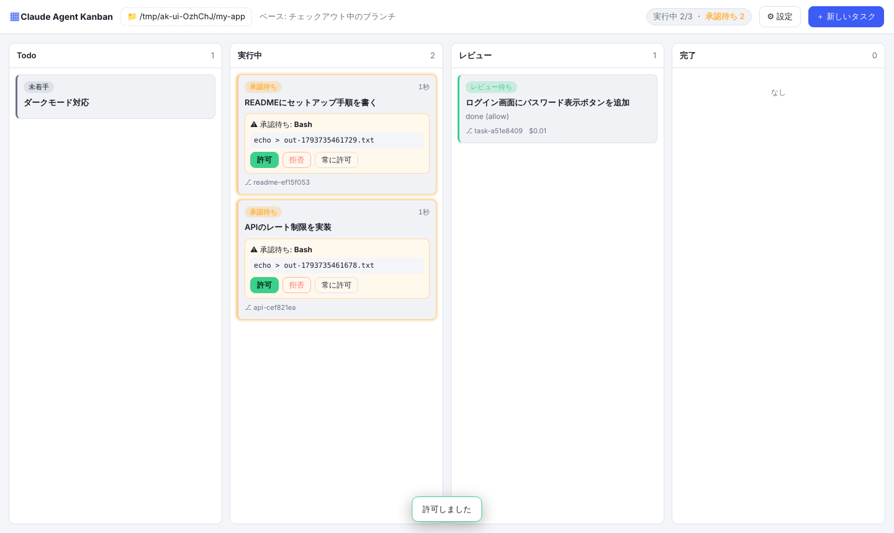

## しくみ

- **1 タスク = 1 worktree = 1 ブランチ**。リポジトリの隣の `<repo>.worktrees/<id>` に worktree を作り、`agent/<内容>-<id>` のブランチで作業させます。作業中のタスク同士や、手元の作業ツリーとはぶつかりません
- **エージェントは CLI をそのまま起動します**。Claude Code は `claude -p --input-format stream-json --output-format stream-json` で動かし、出力をログとしてカードに表示します。ログイン・モデル・`CLAUDE.md`・スキルは、ターミナルで使うときと同じものが使われます
- **承認は Claude Code の `--permission-prompt-tool` で受けます**。権限モードや `--allowedTools` で自動で許可されない操作だけが、カードに「承認待ち」として出ます
- **終わったら、マージ（`--no-ff`）か PR の作成（`gh`）で取り込みます**。マージ先のブランチは選べ、マージしたあとに origin へ push することもできます
- ボードの状態は Electron の userData フォルダの `board.json` に保存します。外部のサーバーは使いません

Codex / Gemini / Cursor では、CLI の制約から、カードでの承認・選択肢の質問・btw・金額の表示が使えません（詳しくは [docs/agents.md](docs/agents.md)）。

## 主な機能

### 複数のリポジトリを並列に動かす
リポジトリはタブで開きます（3 つまで）。タブを切り替えても、ほかのリポジトリのタスクは止まらずに動き続けます。開いていないタブには、**動いているタスクの数**（青）と、**承認・質問などであなたの対応を待っているタスクの数**（橙）が出るので、どのリポジトリで手が必要かがタブだけで分かります。同時に動かすタスクの数の上限（設定の「同時に動かす数」）は、すべてのリポジトリで共有します。

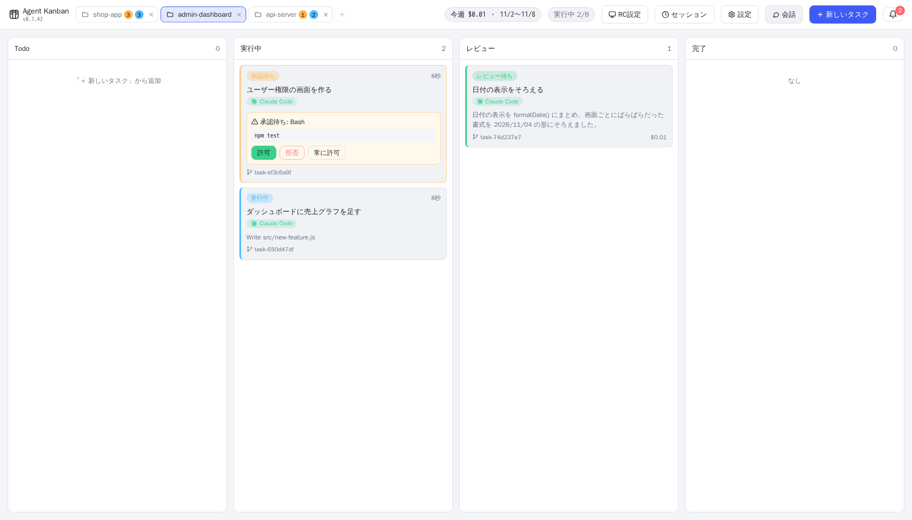

タブの「＋」か、開いているタブを押すと、最近開いたリポジトリから選べます。URL からのクローンや、新しいリポジトリの作成もここからできます。

git で管理していないフォルダ（動画づくりなど、コード以外の作業）も開けます。そのときは worktree を作らずにフォルダの中で直接タスクを動かし、終わったら「完了にする」で完了にします（詳しくは [docs/usage.md](docs/usage.md)）。

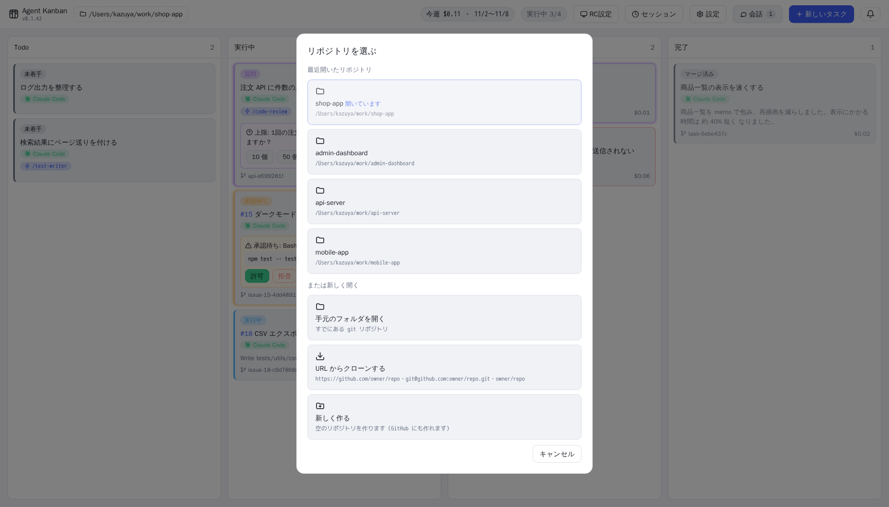

### 承認
許可が必要な操作は、実行しようとしているコマンドと入力の全文をカードと詳細パネルで確かめてから、許可・拒否・このタスクでは常に許可、のどれかを選べます。拒否するときは、理由をエージェントに返せます。

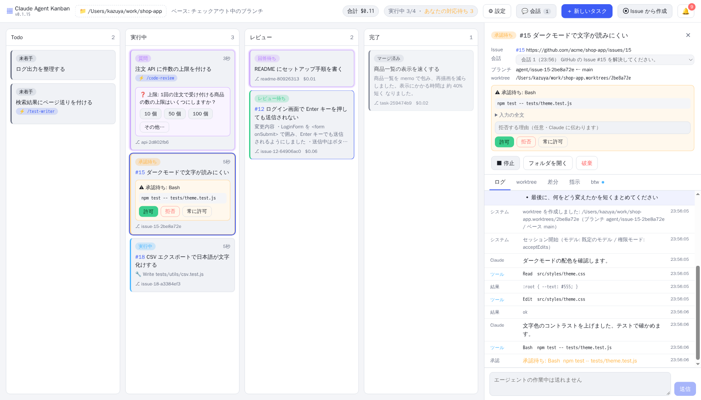

### GitHub Issue からタスクを作る
「新しいタスク」の「GitHub Issue から作成」タブに番号（`21, 22, 24` など）を入れると、Issue のタイトル・本文・コメントから指示を作り、1 Issue につき 1 枚のカードを作ります。ブランチ名は `agent/issue-21-…` になり、PR の本文には `Closes #21` が入ります。`gh` を使います。

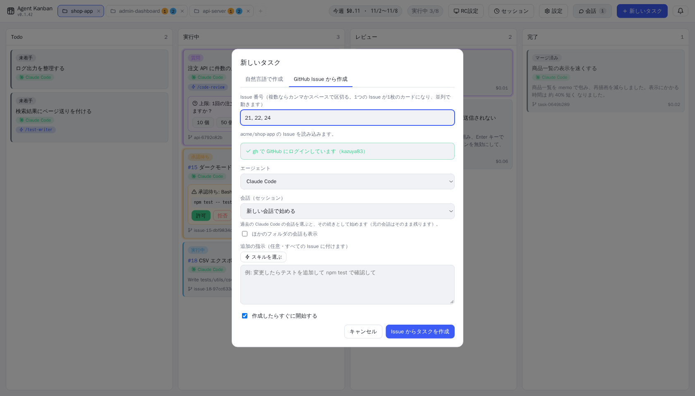

### エージェントからの質問
Claude Code が `AskUserQuestion` で質問すると、カードが「質問」になり、回答フォームが出ます。複数選択と自由入力（その他）にも対応しています。

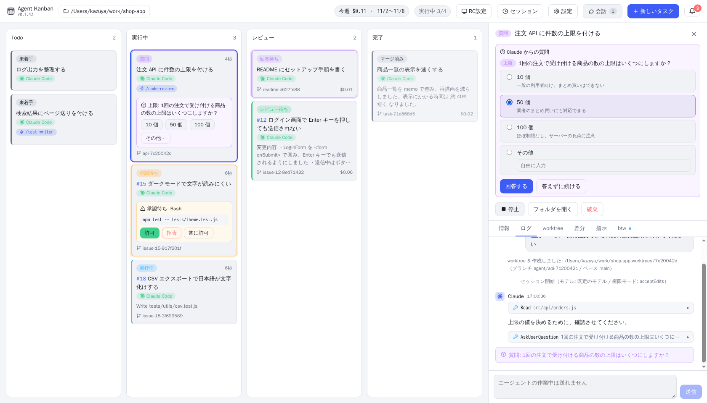

### worktree と差分
「worktree」タブには、ブランチのコミット、未コミットの変更、ベースとの関係、同じリポジトリのほかの worktree が出ます。「差分」タブでは、変わったファイルをフォルダごとのツリーで選んで、ファイルごとに差分を見られます。

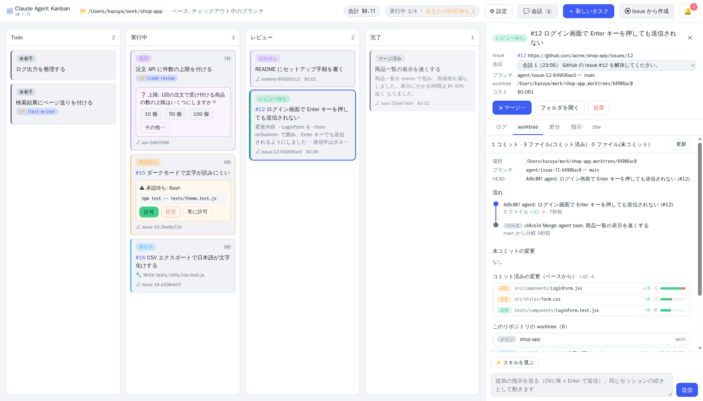

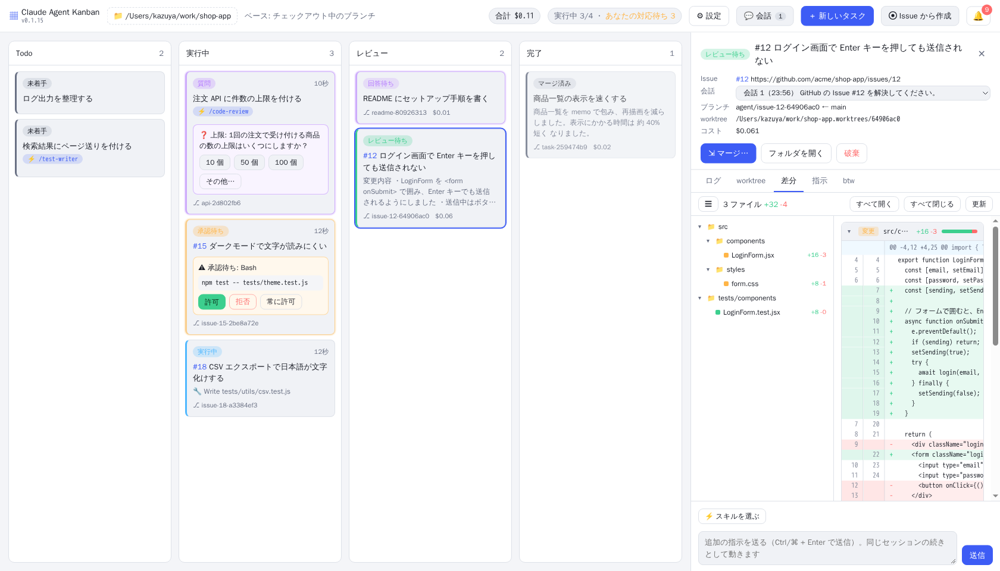

### 会話
「会話」では、タスク（worktree）を作らずに、リポジトリについてエージェントに質問できます。返事は Markdown で表示します。作業させたくなったら「タスクにする」で、その会話の続きとしてタスクにできます。

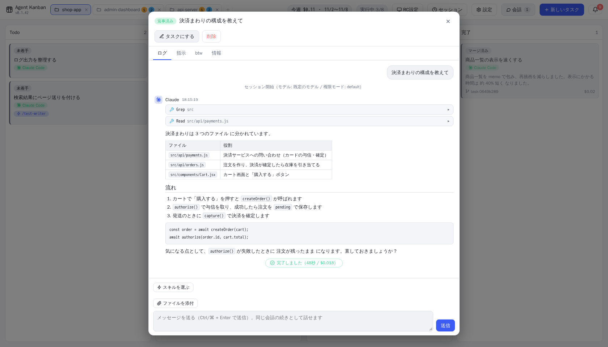

### 通知
承認待ち・質問・回答待ち・レビュー待ち・完了は、右上のベルのアイコンに通知が溜まり、デスクトップ通知も出ます。通知を押すと、そのタスクが開きます。

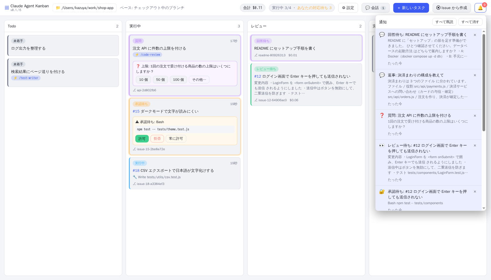

### コンフリクトの解消
マージでコンフリクトが起きると、カードが「コンフリクト」になります。ベースのブランチをタスクのブランチに取り込んだうえで、エージェントに解消させるか、自分でエディタで直すかを選べます。どちらの方法でも、ベースのブランチはマージするまで変わりません。

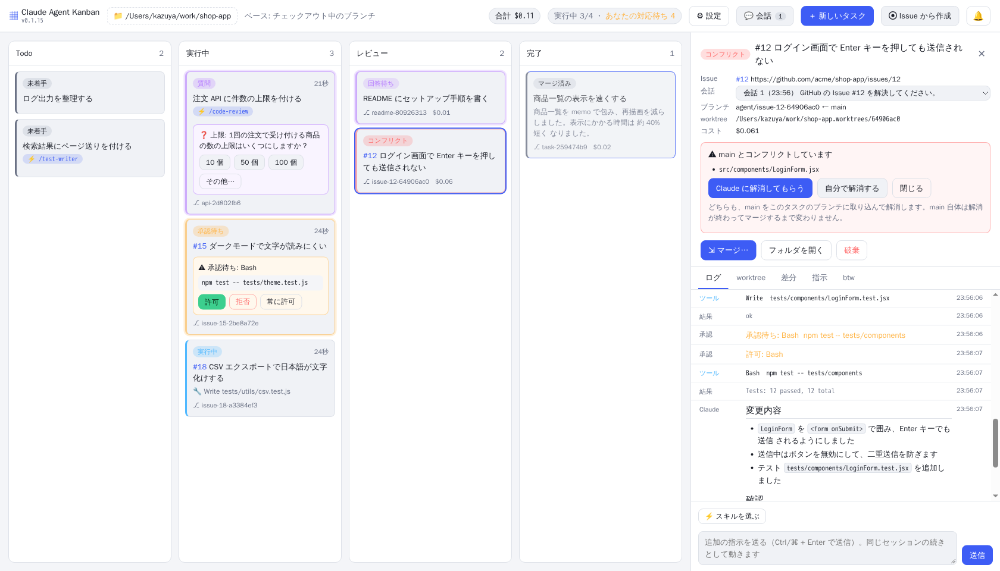

### スキルと過去の会話
タスクを作るときに、Claude Code のスキルを 1 つ選べます（`/スキル名` として渡します）。過去の Claude Code の会話（セッション）を選んで、その続きから始めることもできます。

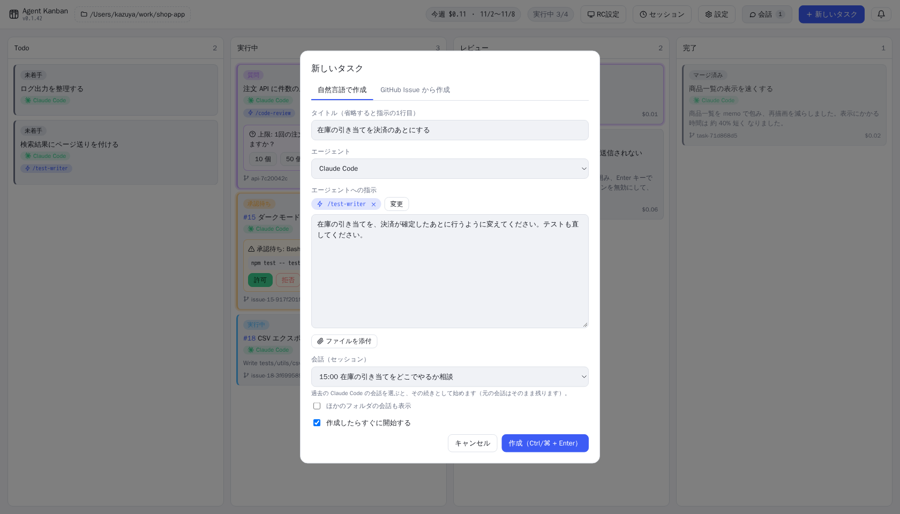

### タスクスケジューラ

トップバーのメニューから「タスクスケジューラ」に切り替えると、決めた日時（1回だけ・毎時・毎日・毎週・毎月）にタスクを作って動かすスケジュールを、カードで管理できます。カンバンのタスクからそのままスケジュールに登録でき、スケジュールから今すぐタスクを作ることもできます。アプリを起動しているあいだだけ動きます（詳しくは [docs/usage.md](docs/usage.md)）。

### 別の PC から操作する（RC）
エージェントを動かしている PC（ホスト）のボードを、別の PC（クライアント）の Agent Kanban から操作できます。Mac と Windows のどちらがホストでも、どちらがクライアントでもかまいません。クライアントでは、承認・質問への回答・追加の指示・マージなどを、ホストの画面と同じように使えます。

- ホストのアプリは `127.0.0.1` だけで待ち受けます。クライアントのアプリが `ssh -N -L` でトンネルを張ってつなぐので、ホストで必要なのは SSH サーバーだけです。外出先からつなぐときは Tailscale などを使います
- SSH は鍵で入ります。クライアントの「RC設定」で ed25519 の鍵（`~/.ssh/agent-kanban_ed25519`）を作り、公開鍵をホストの「RC設定」で登録します
- 初回は、ホストに出る 6 桁のコードでペアリングします。2 回目からは、保存したトークンで、前回の接続先につなぎ直します

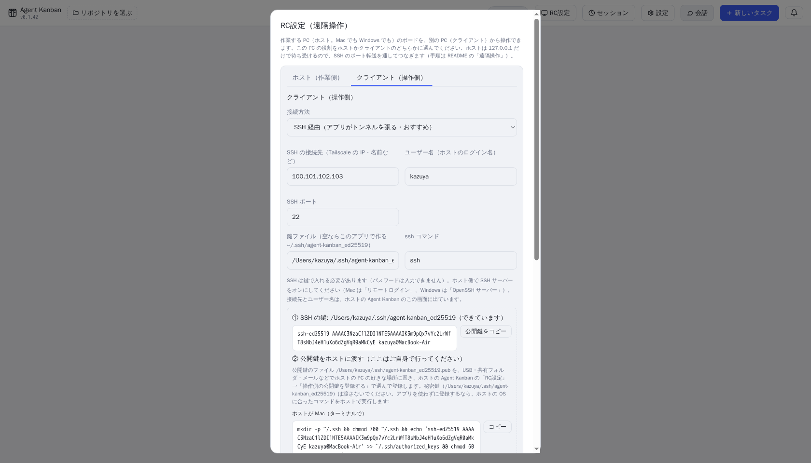

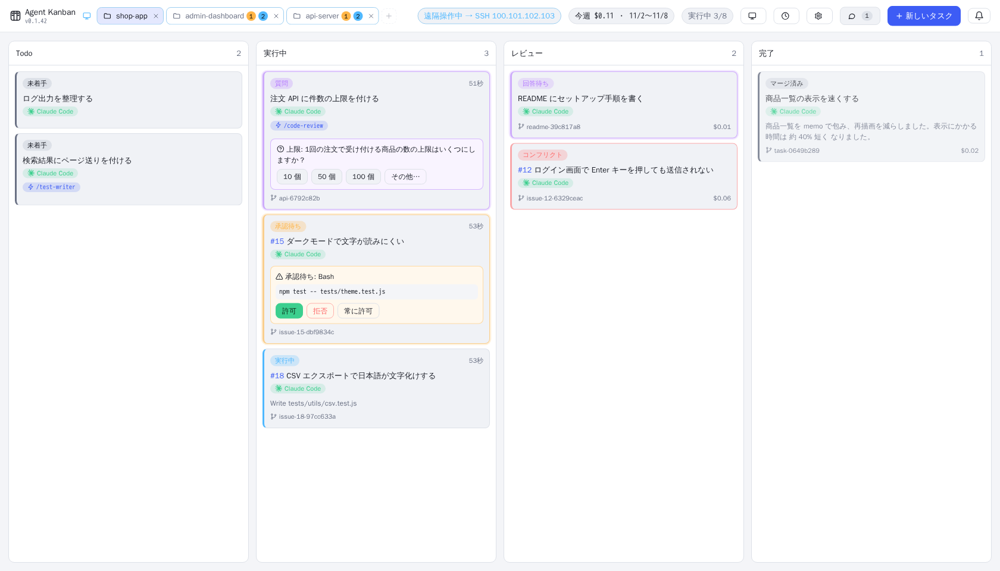

手順と、つながらないときの直し方は [docs/remote.md](docs/remote.md) にあります。

このほか、大きなタスクをサブタスクに分けて並列・順番に進める機能（親のブランチから分けて、終わったものから親のブランチにマージします。サブタスクだけ開始することもできます。GitHub のサブIssue にも対応）、カードの状態（列）のドラッグ&ドロップでの変更、実行中のエージェントへのメッセージ（btw）、画像・ファイルの添付、Pipeline と競争（複数のエージェントの組み合わせ）、Windows での WSL のリポジトリにも対応しています。使い方は [docs/usage.md](docs/usage.md) にまとめています。

## 必要なもの

- git
- 使うエージェントの CLI（Claude Code / Codex CLI / Gemini CLI / Cursor CLI のどれか）。ログインを済ませておきます
- GitHub の Issue・PR の機能を使うときは `gh`（アプリから入れることもできます）

## インストール

**Mac / Linux**

```bash
curl -fsSL https://raw.githubusercontent.com/kazuya83/agent-kanban/main/install.sh | bash
```

**Windows**（PowerShell）

```powershell
irm https://raw.githubusercontent.com/kazuya83/agent-kanban/main/install.ps1 | iex
```

同じコマンドで、最新版へのアップデートもできます。アプリの「設定」→「アプリの更新」の「新しいバージョンに更新」からも更新でき、「新しい版が出たら自動で更新する」にチェックを付けると、タスクが動いていないときに自動で入れ替えて起動し直します。バージョンの指定・アンインストール・ファイルからのインストール・初回起動の警告は [docs/install.md](docs/install.md) を見てください。

## 使い方

1. 「リポジトリを選ぶ」で、作業させる git リポジトリを選びます（URL からのクローンや、新しく作ることもできます）
2. 「新しいタスク」で指示を書いて作成します
3. 承認待ちになったら、カードで許可します
4. レビュー列に移ったら、差分を確かめて「マージ」か「PR を作成」を押します

## ドキュメント

| ドキュメント | 内容 |
| --- | --- |
| [画面と使い方](docs/usage.md) | 承認・質問・仕様の確認・タスクスケジューラ・スキル・会話・btw・マージ / PR・Issue のステータス・通知・コンフリクトなど、機能ごとの使い方 |
| [エージェントとオーケストレーション](docs/agents.md) | Claude Code / Codex / Gemini / Cursor の違い、Pipeline・競争 |
| [設定](docs/settings.md) | 設定画面の項目 |
| [遠隔操作](docs/remote.md) | 別の PC から SSH トンネルでボードを操作する手順と、つながらないときの直し方 |
| [インストール](docs/install.md) | インストール・アップデート・アンインストール、Windows で WSL のリポジトリを使う |
| [開発者向け](docs/development.md) | ソースから動かす・ビルド・リリース・アプリのしくみ・テスト |
