[English](README.md) · [日本語](README.ja.md) · [Español](README.es.md) · [Français](README.fr.md) · [简体中文](README.zh-CN.md)

# Worktree Kanban

> Run AI coding agents in parallel, then control them from another PC: Mac and Windows can each remotely operate the other.

[Website](https://kazuya83.github.io/worktree-kanban/)

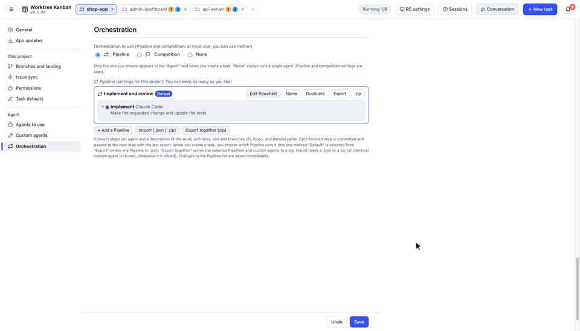

A desktop app (Electron, Mac / Windows / Linux) that runs AI coding-agent CLIs (Claude Code / Codex CLI / Gemini CLI / Cursor CLI) in parallel, each task in its own git worktree, and manages them on a kanban board. **It can run tasks from more than one repository at the same time, not only tasks inside a single repository.**

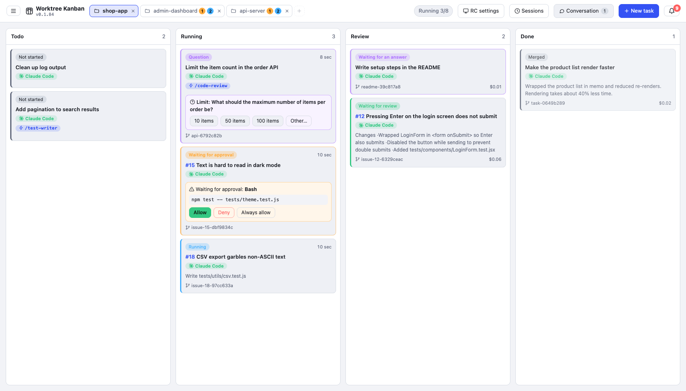

## How it works

- **1 task = 1 worktree = 1 branch.** It creates a worktree at `<repo>.worktrees/<id>` next to the repository and works on a branch named `agent/<summary>-<id>`. Tasks do not collide with each other or with the working tree you have open
- **The agent is the CLI, started as-is.** Claude Code runs as `claude -p --input-format stream-json --output-format stream-json`, and its output is shown on the card as the log. Sign-in, model, `CLAUDE.md`, and skills are the same ones you use in the terminal
- **Approval goes through Claude Code's `--permission-prompt-tool`.** Only actions that the permission mode or `--allowedTools` does not auto-allow show up on the card as waiting for approval
- **When it finishes, you bring the work in by merging (`--no-ff`) or opening a PR (`gh`).** You can choose the target branch, and you can push to origin after the merge
- Board state is stored in `board.json` in Electron's userData folder. There is no external server

On Codex / Gemini / Cursor, in-card approval, multiple-choice questions, btw, and cost display are unavailable because of CLI limits (see [docs/agents.md](docs/agents.md) (Japanese)).

## Features

### Operate from another PC (RC)

You can operate the board on the PC that runs the agents (the host) from Worktree Kanban on another PC (the client). Either Mac or Windows can be the host, and either can be the client. On the client you can approve, answer questions, send extra instructions, merge, and so on, the same way as on the host screen.

- The host app listens only on `127.0.0.1`. The client app connects with an `ssh -N -L` tunnel, so the host only needs an SSH server. Use Tailscale or similar when you connect from outside
- SSH uses a key. In the client's "RC settings", create an ed25519 key (`~/.ssh/agent-kanban_ed25519`) and register the public key in the host's "RC settings"
- The first time, you pair with a 6-digit code shown on the host. After that, a saved token reconnects to the previous destination

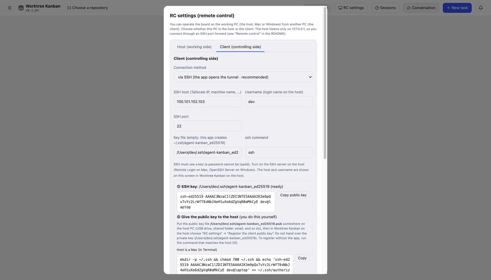

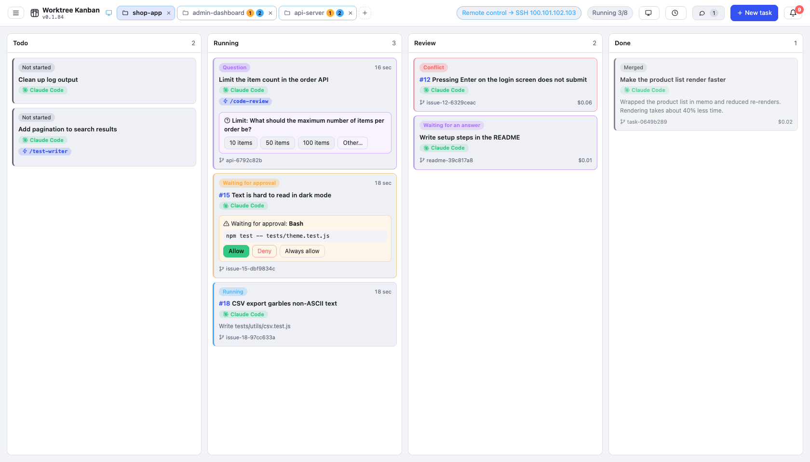

Steps, and how to fix a connection that fails, are in [docs/remote.md](docs/remote.md) (Japanese).

Also included: splitting a large task into subtasks that run in parallel or in order (branched from the parent branch and merged back when done; you can also start a single subtask; GitHub sub-issues are supported), drag-and-drop changes to a card's state (column), messages to a running agent (btw), image and file attachments, Pipeline and competition (combinations of several agents), and WSL repositories on Windows. Usage is summarized in [docs/usage.md](docs/usage.md) (Japanese).

### Run several repositories in parallel

Repositories open as tabs (up to 3). Switching tabs does not stop tasks in the other repositories. A tab that is not selected shows **how many tasks are running** (blue) and **how many tasks are waiting for you** (approval, a question, and so on, in orange), so you can see which repository needs you from the tabs alone. The limit on how many tasks run at once (the setting for how many to run at once) is shared across every repository.

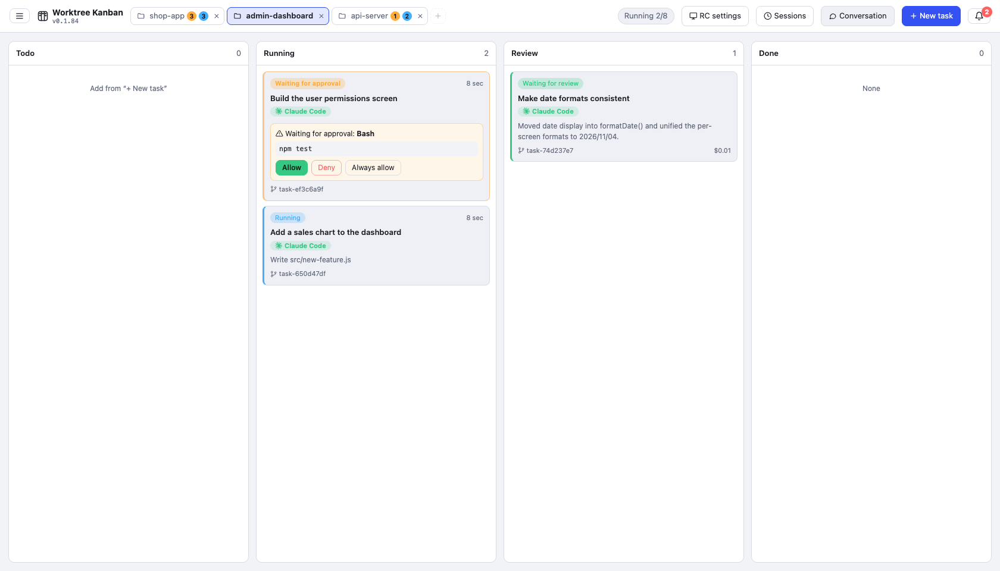

The "+" on the tab bar, or clicking the open tab, lets you pick from recently opened repositories. You can also clone from a URL or create a new repository from there.

You can open a folder that is not a git repository (video production and other work that is not code). In that case it runs the task directly in the folder without creating a worktree, and you finish it with "Mark done" (see [docs/usage.md](docs/usage.md) (Japanese)).

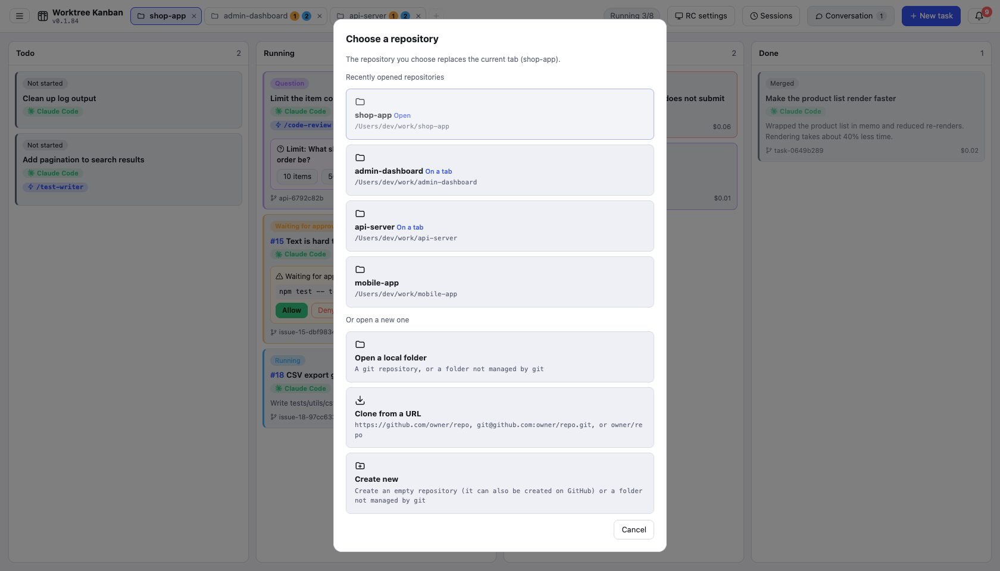

### Approval

When an action needs permission, you can read the full command and input on the card and in the detail panel, then choose allow, deny, or always allow for this task. When you deny, you can send a reason back to the agent.

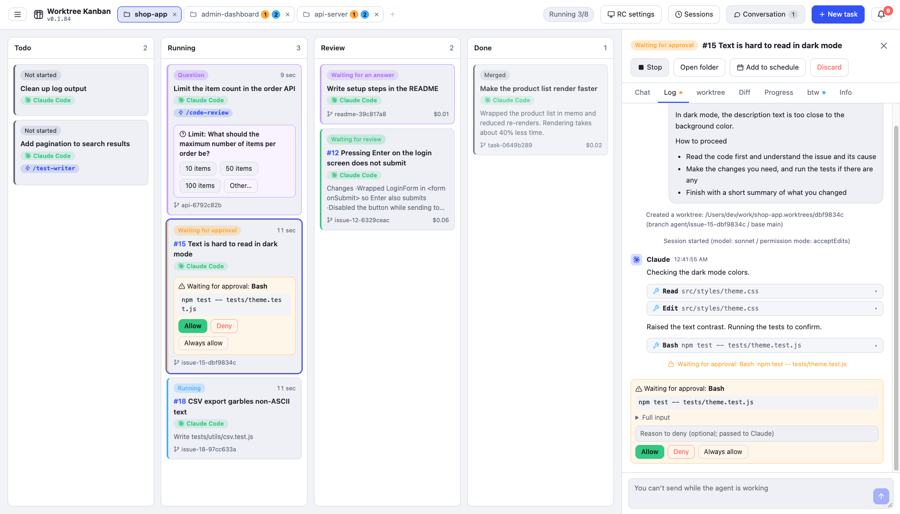

### Create tasks from GitHub Issues

On the "Create from GitHub Issue" tab of "New task", enter numbers (`21, 22, 24`, and so on). It builds the instructions from the Issue title, body, and comments, and creates one card per Issue. The branch is named `agent/issue-21-…`, and the PR body includes `Closes #21`. This uses `gh`.

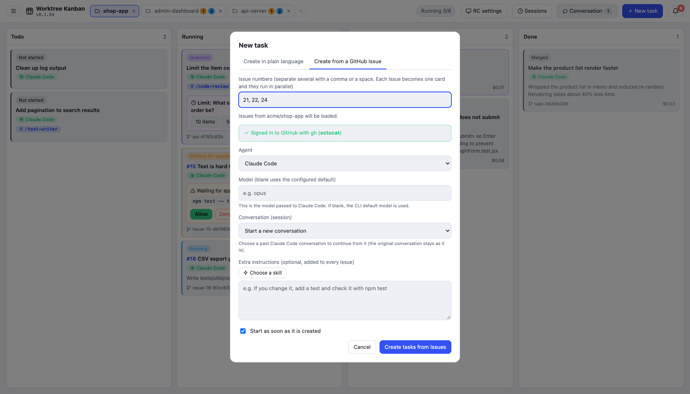

### Questions from the agent

When Claude Code asks with `AskUserQuestion`, the card becomes a question and an answer form appears. Multiple choice and free text (Other) are both supported.

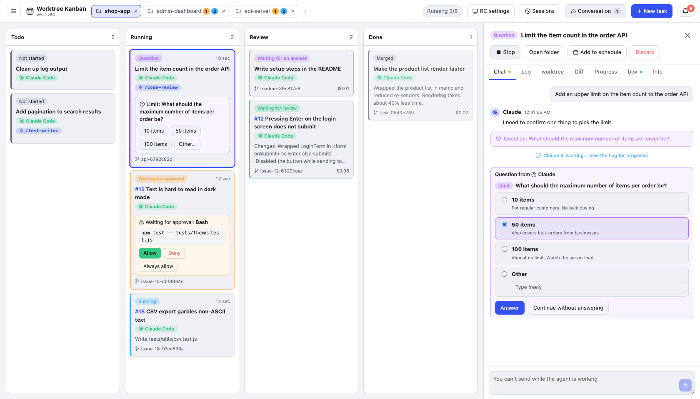

### worktree and diff

The "worktree" tab shows the branch commits, uncommitted changes, how the branch relates to the base, and the other worktrees in the same repository. On the "diff" tab you pick changed files in a tree grouped by folder and read the diff file by file.

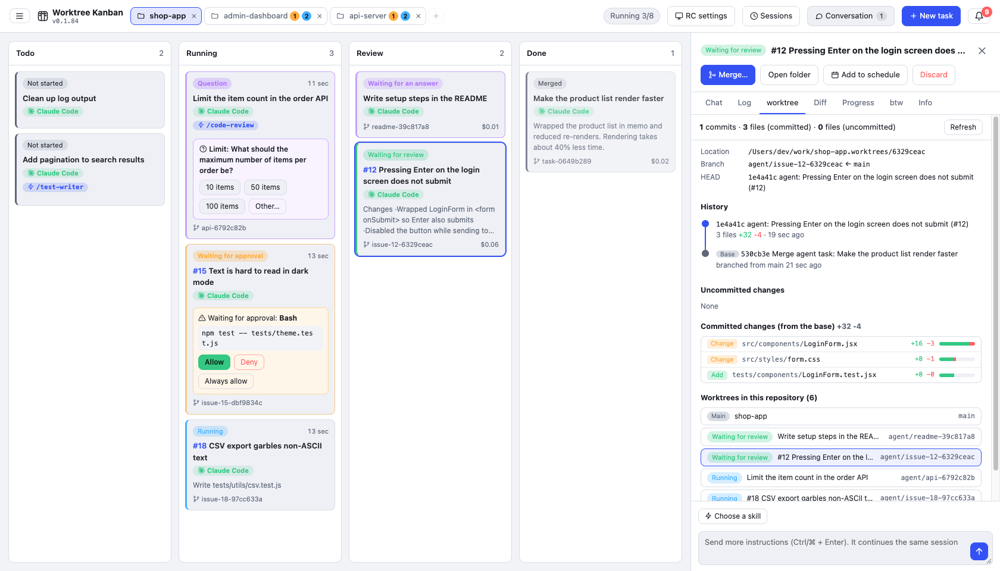

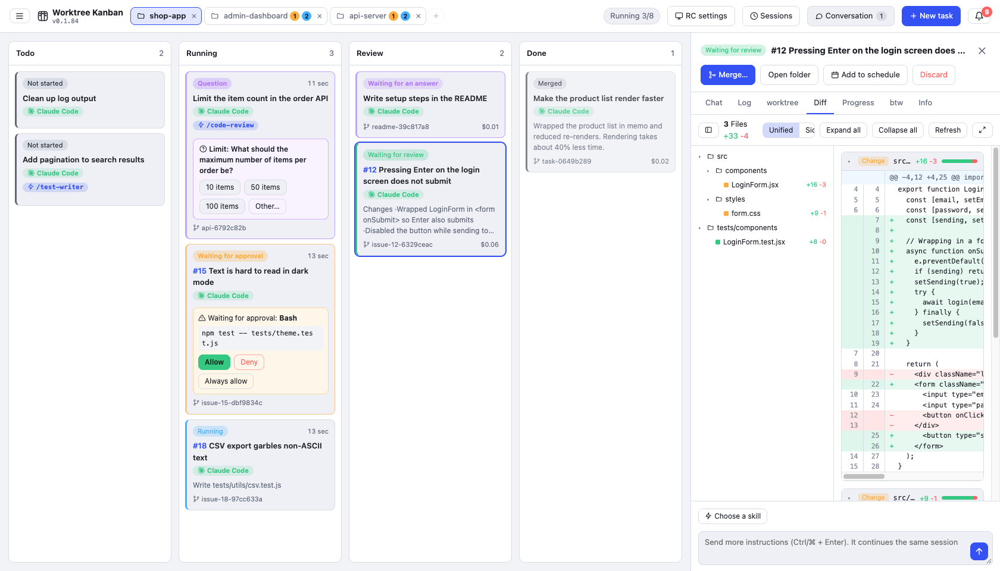

### Chat

In "Chat" you can ask the agent about the repository without creating a task (worktree). Replies are shown as Markdown. When you want it to start working, "Make this a task" continues that conversation as a task.

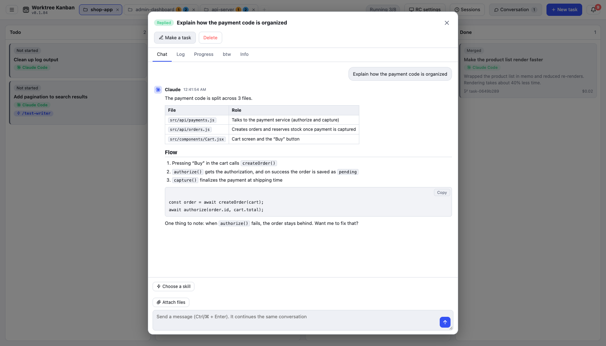

### Notifications

Waiting for approval, questions, waiting for an answer, waiting for review, and completion collect on the bell icon at the top right, and a desktop notification is shown. Clicking a notification opens that task.

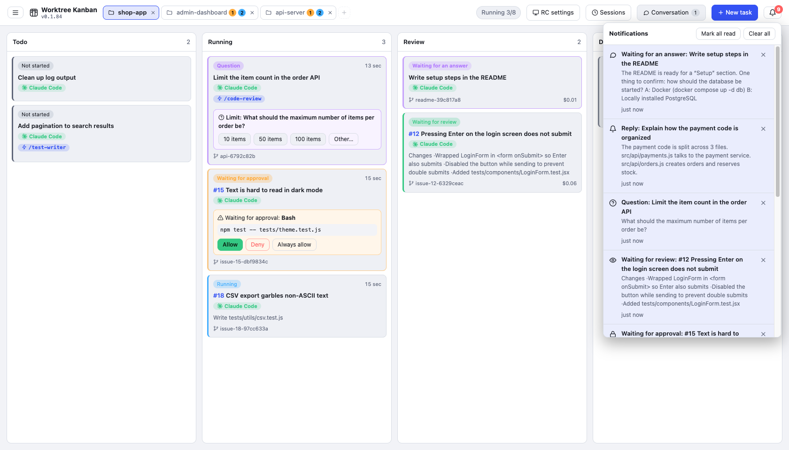

### Resolving conflicts

If a merge conflicts, the card becomes a conflict. After the base branch is merged into the task branch, you can have the agent resolve it or fix it yourself in an editor. Either way, the base branch stays unchanged until you merge.

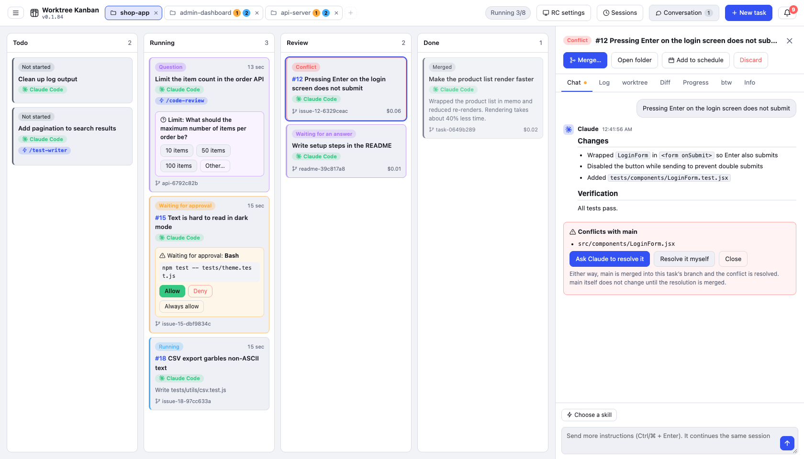

### Skills and past conversations

When you create a task, you can pick one Claude Code skill (it is passed as `/skill-name`). You can also pick a past Claude Code conversation (session) and start from where it left off.

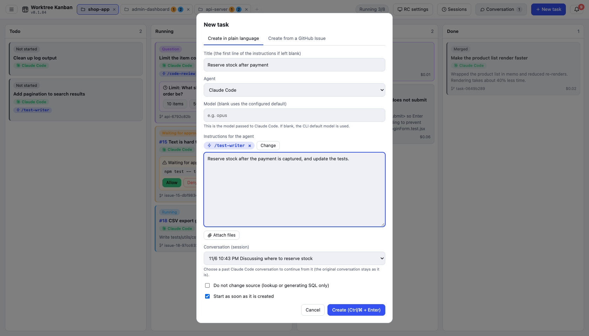

### Task scheduler

From the menu in the top bar, switch to "Task scheduler" to manage schedules that create and run a task at a set time (once, hourly, daily, weekly, or monthly) as cards. You can register a kanban task as a schedule directly, and you can create a task from a schedule right away. Schedules run only while the app is open (see [docs/usage.md](docs/usage.md) (Japanese)).

## Requirements

- git
- The CLI of the agent you use (one of Claude Code / Codex CLI / Gemini CLI / Cursor CLI), already signed in
- `gh`, if you use GitHub Issues and PRs (you can also install it from the app)

## Install

**Mac / Linux**

```bash
curl -fsSL https://raw.githubusercontent.com/kazuya83/worktree-kanban/main/install.sh | bash
```

**Windows** (PowerShell)

```powershell
irm https://raw.githubusercontent.com/kazuya83/worktree-kanban/main/install.ps1 | iex
```

The same commands update to the latest version. You can also update from the app: "Settings" → "App update" → "Update to the new version". If you check "Update automatically when a new version is out", it replaces itself and relaunches when no task is running. For pinning a version, uninstalling, installing from a downloaded file, and the first-launch warning, see [docs/install.md](docs/install.md) (Japanese).

## Usage

1. In "Choose a repository", pick the git repository to work in (you can also clone from a URL or create a new one)
2. In "New task", write the instructions and create it
3. When it is waiting for approval, allow it on the card
4. When it moves to the Review column, check the diff and press "Merge" or "Create PR"

## Documentation

| Document | Contents |
| --- | --- |
| [Screen and usage](docs/usage.md) (Japanese) | How to use each feature: approval, questions, spec check, task scheduler, skills, chat, btw, merge / PR, Issue status, notifications, conflicts, and more |
| [Agents and orchestration](docs/agents.md) (Japanese) | Differences between Claude Code / Codex / Gemini / Cursor, Pipeline and competition |
| [Settings](docs/settings.md) (Japanese) | The settings screen opened from the top-bar menu, and its items |
| [Remote control](docs/remote.md) (Japanese) | How to operate the board from another PC over an SSH tunnel, and how to fix a connection that fails |
| [Install](docs/install.md) (Japanese) | Install, update, uninstall, and using a WSL repository on Windows |
| [For developers](docs/development.md) (Japanese) | Run from source, build, release, how the app is built, and tests |

## License

Released under the [MIT License](LICENSE).
