<div align="center">


# Worktree Kanban

<strong>并行运行 AI 编程代理，并从另一台电脑操作。</strong><br />
Mac 和 Windows 可以互相远程控制。

[官网](https://kazuya83.github.io/worktree-kanban/) · [下载](https://github.com/kazuya83/worktree-kanban/releases/latest)

[](https://github.com/kazuya83/worktree-kanban/releases/latest)
[](https://github.com/kazuya83/worktree-kanban/releases/latest)
[](docs/images/en/rc-client.png)
[](https://github.com/kazuya83/worktree-kanban#readme)
[](LICENSE)

[English](README.md) · [日本語](README.ja.md) · [Español](README.es.md) · [Français](README.fr.md) · [简体中文](README.zh-CN.md)

</div>

<div align="center">

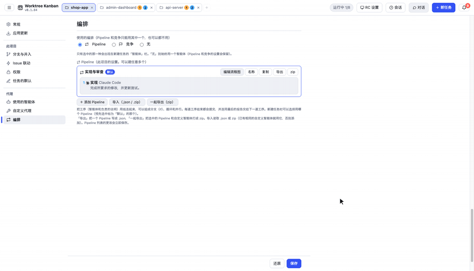

</div>

这是一个桌面应用（Electron，Mac / Windows / Linux）。它把 AI 编程智能体的 CLI（Claude Code / Codex CLI / Gemini CLI / Cursor CLI）按任务放进各自的 git worktree 里并行运行，并用看板管理。**不限于同一个仓库里的任务，多个仓库的任务也可以同时进行。**

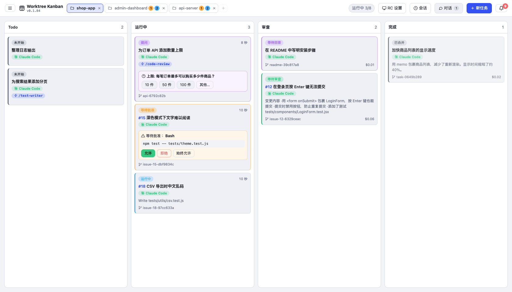

## 为什么选择 Worktree Kanban

- **Mac ⇄ Windows 互相远程控制** — 在一台电脑上运行代理，在另一台电脑上操作同一个看板：批准、回答问题、发送指示、合并。
- **一个任务，一个 worktree** — 每个任务都有自己的 git worktree 和分支，任务之间、任务与你的工作区都不会冲突。
- **同时处理多个仓库** — 最多可用标签页打开 3 个仓库，切换标签页不会中断任何任务。
- **沿用你现有的 CLI** — Claude Code、Codex CLI、Gemini CLI、Cursor CLI，登录和设置保持不变。
- **最终由你决定** — 合并或创建 PR 前可以查看差异。使用 Claude Code 时，还可以在卡片上批准操作。
- **完全本地** — 看板状态保存在你的电脑上，不使用外部服务器。

## 工作方式

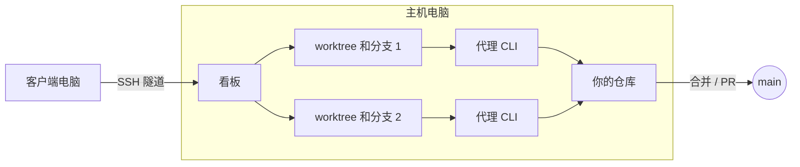

- **1 个任务 = 1 个 worktree = 1 个分支。** 在仓库旁边的 `<repo>.worktrees/<id>` 创建 worktree，并在名为 `agent/<概要>-<id>` 的分支上工作。进行中的任务彼此不会冲突，也不会和你手头的工作树冲突
- **智能体就是原样启动的 CLI。** Claude Code 以 `claude -p --input-format stream-json --output-format stream-json` 运行，输出作为日志显示在卡片上。登录、模型、`CLAUDE.md` 和技能，与你在终端里使用的是同一套
- **批准通过 Claude Code 的 `--permission-prompt-tool` 接收。** 只有权限模式或 `--allowedTools` 不会自动允许的操作，才会在卡片上显示为等待批准
- **结束后，用合并（`--no-ff`）或创建 PR（`gh`）把结果收进来。** 可以选择合并到哪条分支，合并之后也可以 push 到 origin
- 看板状态保存在 Electron 的 userData 文件夹里的 `board.json`。不使用外部服务器

在 Codex / Gemini / Cursor 上，由于 CLI 的限制，不能使用卡片上的批准、选择题提问、btw 和金额显示（详见 [docs/agents.md](docs/agents.md) (English)）。

## 主要功能

### 从另一台电脑操作（RC）

可以在另一台电脑（客户端）的 Worktree Kanban 上，操作正在运行智能体的那台电脑（主机）的看板。Mac 和 Windows 都可以做主机，也都可以做客户端。在客户端上，批准、回答提问、追加指示、合并等，都可以像主机画面一样使用。

- 主机上的应用只在 `127.0.0.1` 上等待连接。客户端应用用 `ssh -N -L` 建立隧道来连接，所以主机上只需要 SSH 服务器。从外面连接时使用 Tailscale 等
- SSH 使用密钥登录。在客户端的「RC 设置」里创建 ed25519 密钥（`~/.ssh/agent-kanban_ed25519`），再把公钥登记到主机的「RC 设置」
- 第一次用主机上显示的 6 位代码配对。之后用保存的令牌重新连上一次的目标

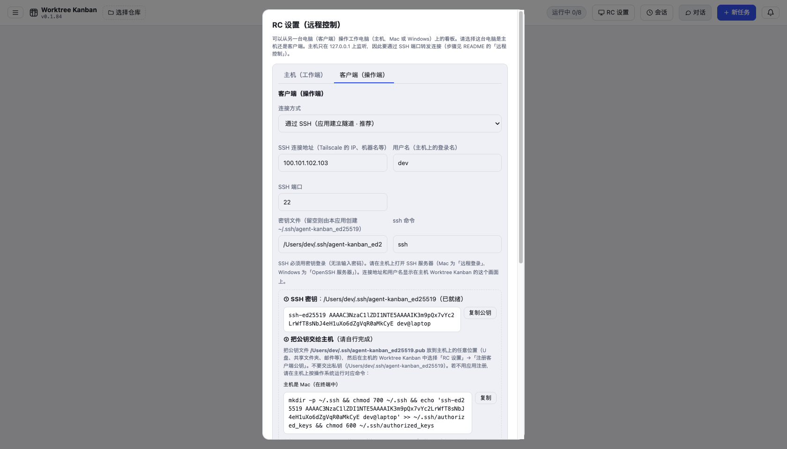

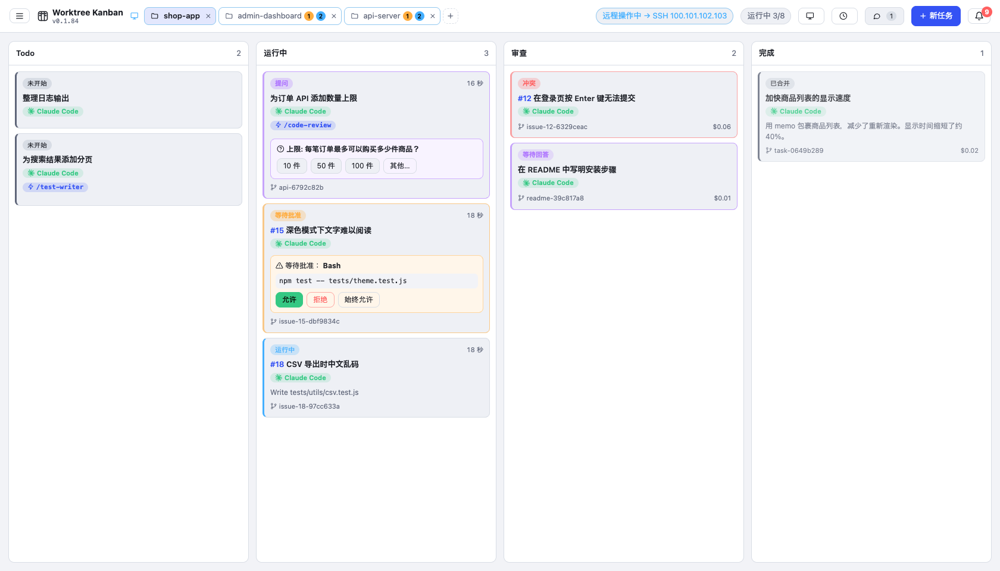

步骤，以及连不上时的处理方法，写在 [docs/remote.md](docs/remote.md) (English)。

此外还支持：把大任务拆成子任务，并行或按顺序推进（从父分支分出去，完成后合并回父分支；也可以只启动某一个子任务；支持 GitHub 的子 Issue）、用拖放改变卡片的状态（列）、给正在运行的智能体发消息（btw）、附加图片和文件、Pipeline 与竞争（多个智能体的组合），以及在 Windows 上使用 WSL 的仓库。用法汇总在 [docs/usage.md](docs/usage.md) (English)。

### 并行运行多个仓库

仓库以标签页打开（最多 3 个）。切换标签页不会让其他仓库的任务停下来。未选中的标签会显示**正在运行的任务数**（蓝色）和**正在等你处理的任务数**（批准、提问等，橙色），所以只看标签就能知道哪个仓库需要你动手。同时运行的任务数上限（设置里的「同时运行数量」）在所有仓库之间共享。

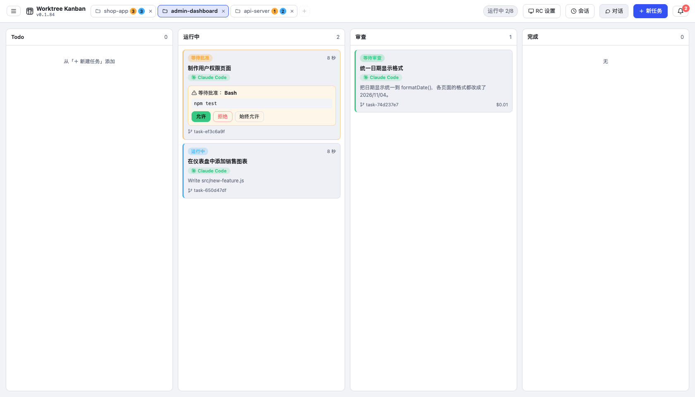

按标签栏的「＋」，或按一下已打开的标签，就能从最近打开的仓库里选择。也可以从这里用 URL 克隆，或新建一个仓库。

没有用 git 管理的文件夹（做视频等代码以外的工作）也可以打开。这时不创建 worktree，直接在文件夹里运行任务，结束后用「标为完成」结束（详见 [docs/usage.md](docs/usage.md) (English)）。

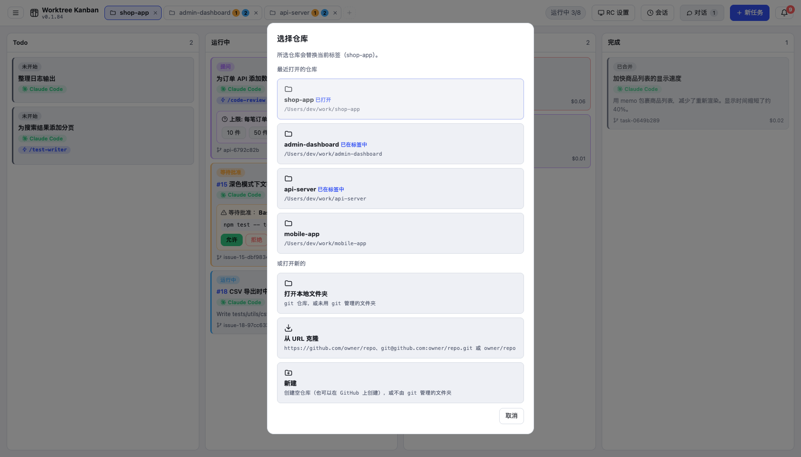

### 批准

需要许可的操作，可以在卡片和详情面板里看完将要执行的命令和全部输入，再选择允许、拒绝，或在这个任务里始终允许。拒绝时可以把理由返回给智能体。

<details>
<summary>查看截图</summary>

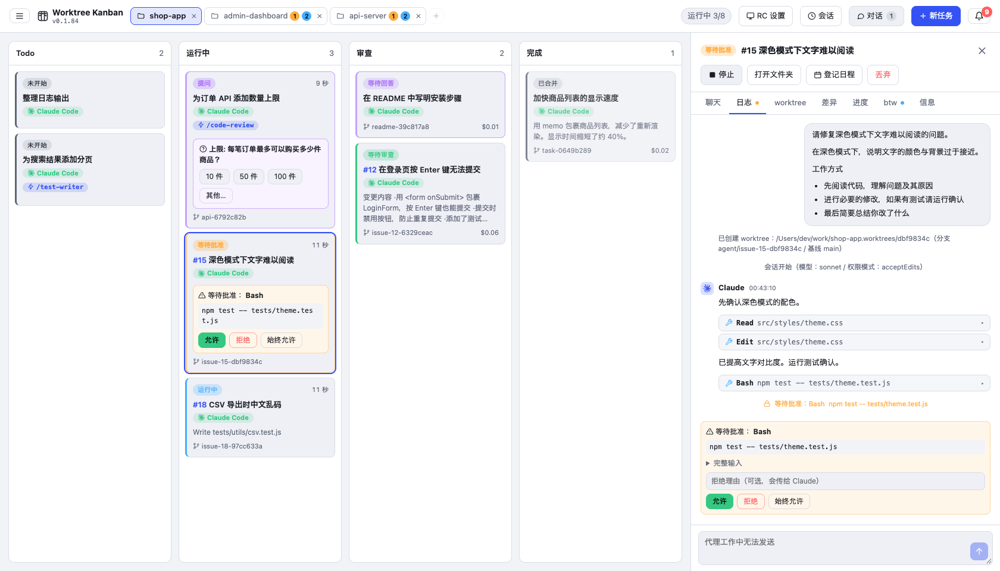

</details>

### 从 GitHub Issue 创建任务

在「新建任务」的「从 GitHub Issue 创建」标签里填入编号（如 `21, 22, 24`）。它会根据 Issue 的标题、正文和评论生成指示，每个 Issue 一张卡片。分支名为 `agent/issue-21-…`，PR 正文里会写入 `Closes #21`。使用 `gh`。

<details>
<summary>查看截图</summary>

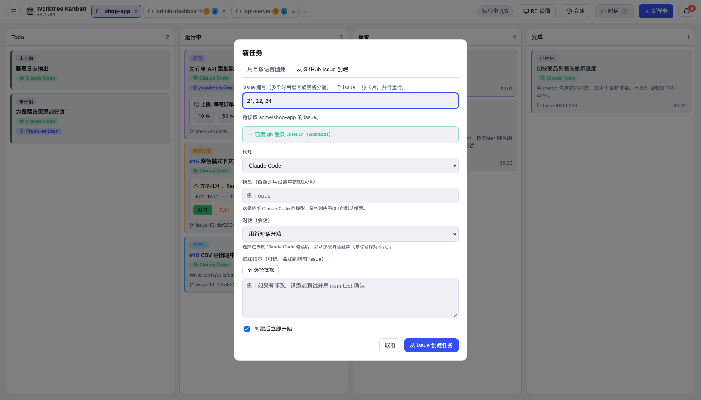

</details>

### 来自智能体的提问

Claude Code 用 `AskUserQuestion` 提问时，卡片会变成提问，并出现回答表单。支持多选和自由输入（其他）。

<details>
<summary>查看截图</summary>

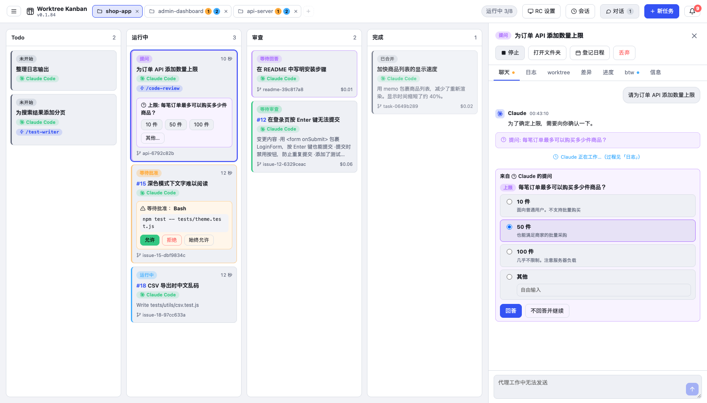

</details>

### worktree 与 diff

「worktree」标签会显示分支的提交、未提交的更改、与基线的关系，以及同一仓库的其他 worktree。「diff」标签里，可以按文件夹树选择改过的文件，逐个查看差异。

<details>
<summary>查看截图</summary>

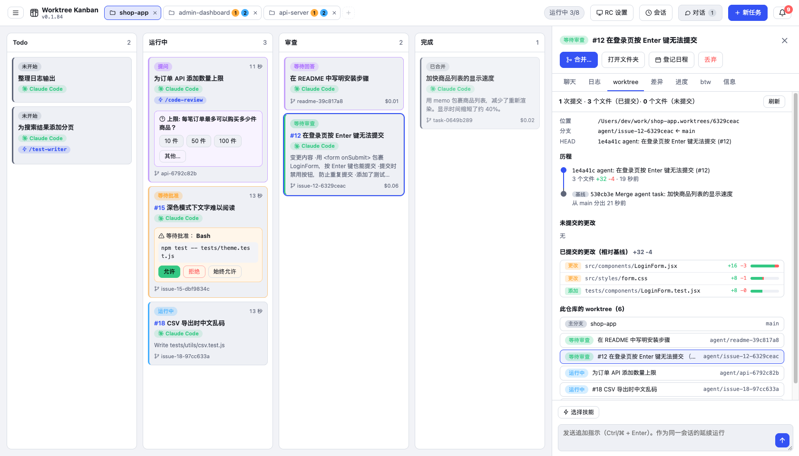

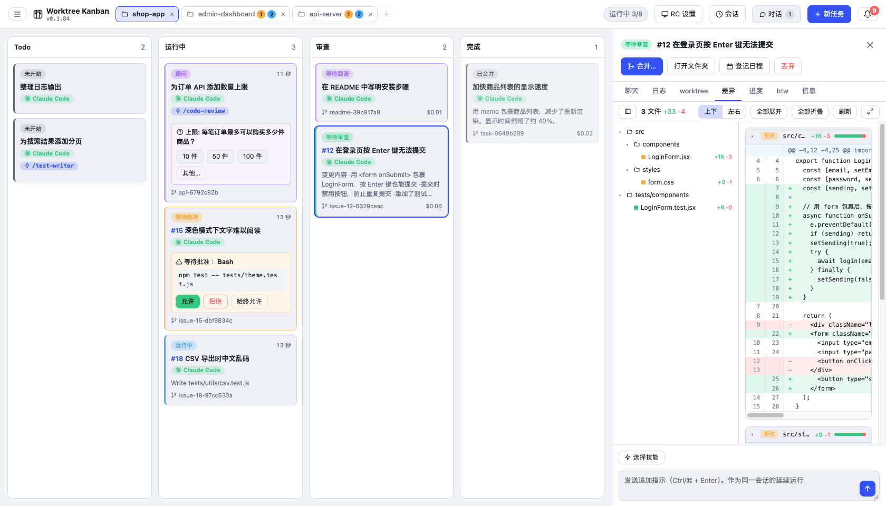

</details>

### 对话

在「对话」里，不必创建任务（worktree），就可以向智能体询问这个仓库。回复以 Markdown 显示。想让它开始干活时，用「变成任务」，把这段对话接着做成任务。

<details>
<summary>查看截图</summary>

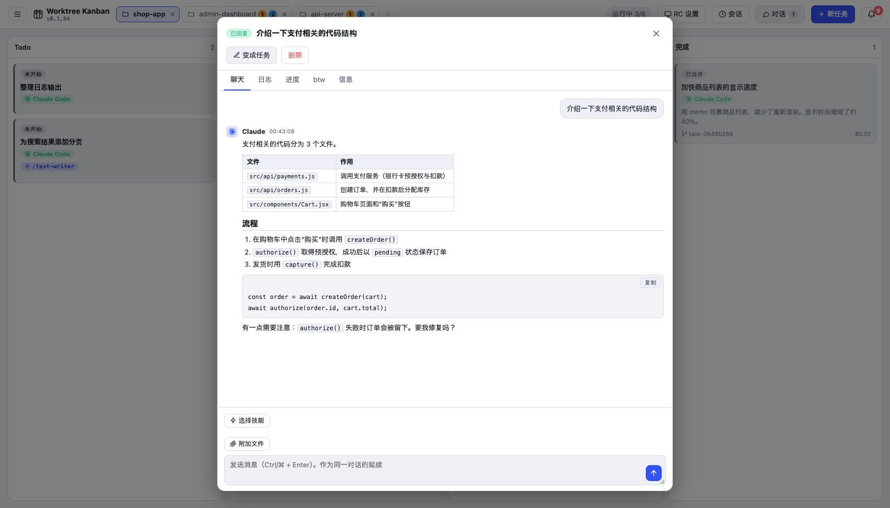

</details>

### 通知

等待批准、提问、等待回答、等待评审和完成，会积在右上角的铃铛图标里，同时也会发出桌面通知。按下通知就会打开那个任务。

<details>
<summary>查看截图</summary>

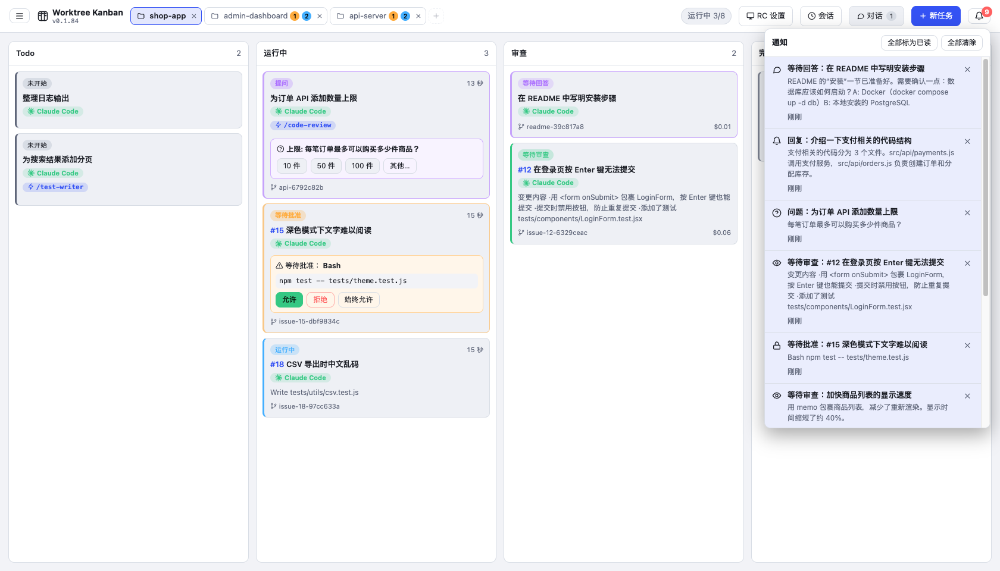

</details>

### 解决冲突

合并发生冲突时，卡片会变成冲突。先把基线分支并入任务分支，然后可以选择让智能体解决，或自己在编辑器里修改。无论哪种方式，在你合并之前，基线分支都不会改变。

<details>
<summary>查看截图</summary>

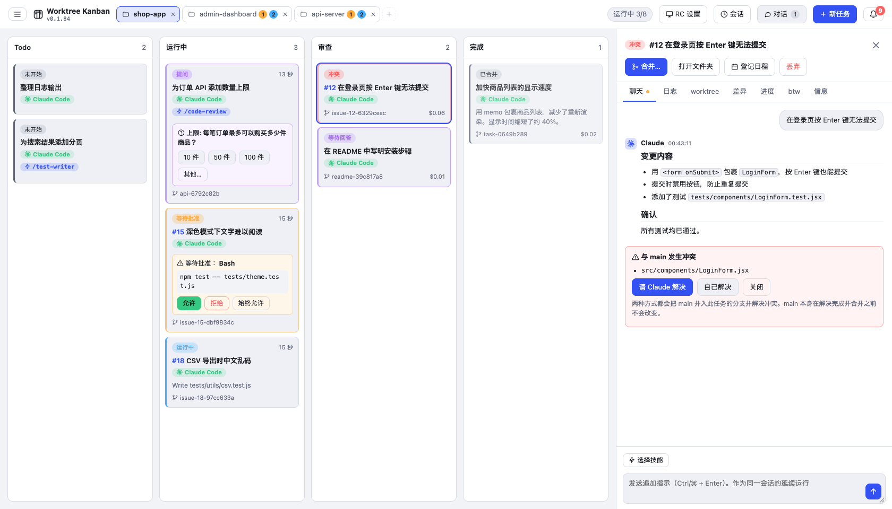

</details>

### 技能与过去的对话

创建任务时，可以选择一项 Claude Code 的技能（以 `/技能名` 传入）。也可以选择过去的 Claude Code 对话（会话），从那里继续。

<details>
<summary>查看截图</summary>

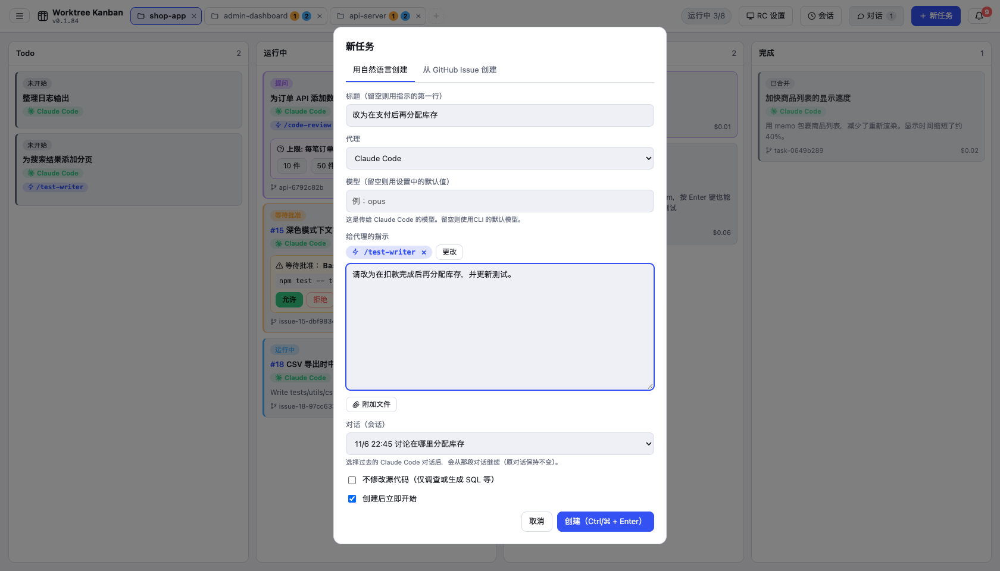

</details>

### 任务调度

从顶栏菜单切换到「任务调度」，就可以用卡片管理在指定时间（仅一次、每小时、每天、每周、每月）创建并运行任务的日程。看板任务可以直接登记成日程，也可以从日程立刻创建任务。只有在应用开着的时候才会运行（详见 [docs/usage.md](docs/usage.md) (English)）。

## 需要准备

- git
- 要使用的智能体 CLI（Claude Code / Codex CLI / Gemini CLI / Cursor CLI 之一），并已登录
- 使用 GitHub 的 Issue 和 PR 时需要 `gh`（也可以从应用里安装）

## 安装

**Mac / Linux**

```bash
curl -fsSL https://raw.githubusercontent.com/kazuya83/worktree-kanban/main/install.sh | bash
```

**Windows**（PowerShell）

```powershell
irm https://raw.githubusercontent.com/kazuya83/worktree-kanban/main/install.ps1 | iex
```

用同样的命令也可以更新到最新版。也可以从应用里更新：「设置」→「应用更新」→「更新到新版本」。勾选「有新版本时自动更新」后，会在没有任务运行时自动替换并重新启动。指定版本、卸载、从文件安装，以及首次启动时的警告，请看 [docs/install.md](docs/install.md) (English)。

## 用法

1. 在「选择仓库」里选择要工作的 git 仓库（也可以从 URL 克隆，或新建一个）
2. 在「新建任务」里写下指示并创建
3. 进入等待批准时，在卡片上允许
4. 移到评审列后，确认差异，按「合并」或「创建 PR」

## 文档

| 文档 | 内容 |
| --- | --- |
| [画面与用法](docs/usage.md) (English) | 各项功能的用法：批准、提问、规格确认、任务调度、技能、对话、btw、合并 / PR、Issue 状态、通知、冲突等 |
| [智能体与编排](docs/agents.md) (English) | Claude Code / Codex / Gemini / Cursor 的差异，Pipeline 与竞争 |
| [设置](docs/settings.md) (English) | 从顶栏菜单打开的设置画面和各个项目 |
| [远程操作](docs/remote.md) (English) | 通过 SSH 隧道从另一台电脑操作看板的步骤，以及连不上时的处理方法 |
| [安装](docs/install.md) (English) | 安装、更新、卸载，以及在 Windows 上使用 WSL 仓库 |
| [面向开发者](docs/development.md) (English) | 从源码运行、构建、发布、应用的结构，以及测试 |
| [从 Vibe Kanban 迁移](https://kazuya83.github.io/worktree-kanban/migrate-from-vibe-kanban.html) (English) | Vibe Kanban 发生了什么、可以保留什么，以及迁移步骤 |

## 许可证

基于 [Functional Source License 1.1（FSL-1.1-ALv2）](LICENSE) 发布。除用于竞争性的商业产品或服务外，可以使用、修改和再分发。每个版本在发布两年后也可按 Apache License 2.0 使用。
