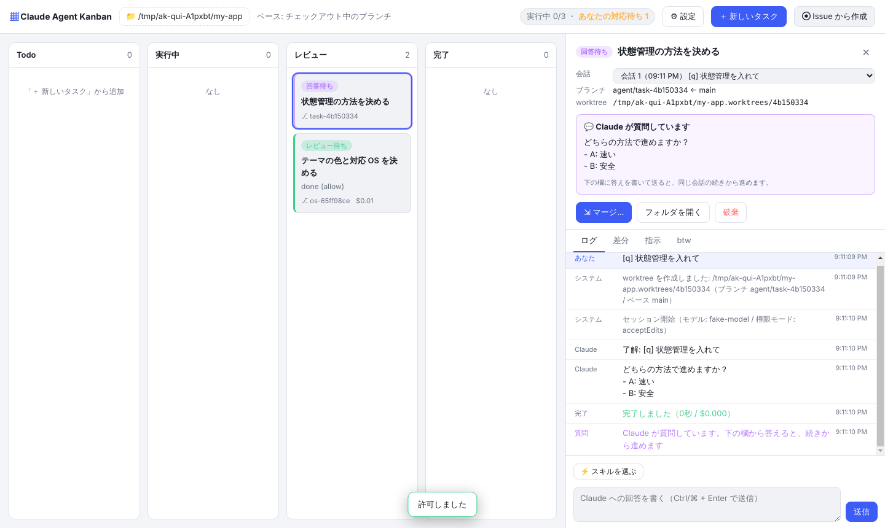
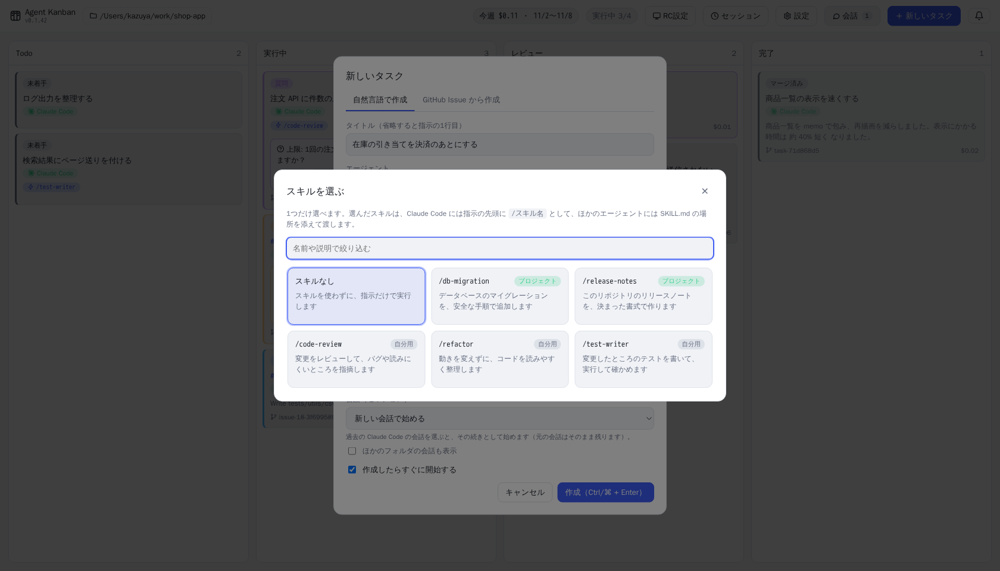
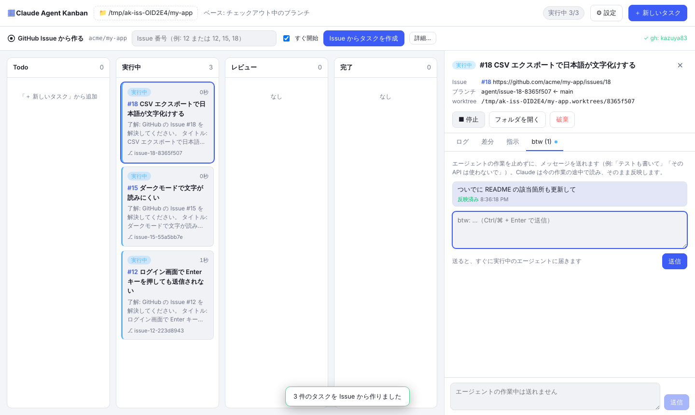
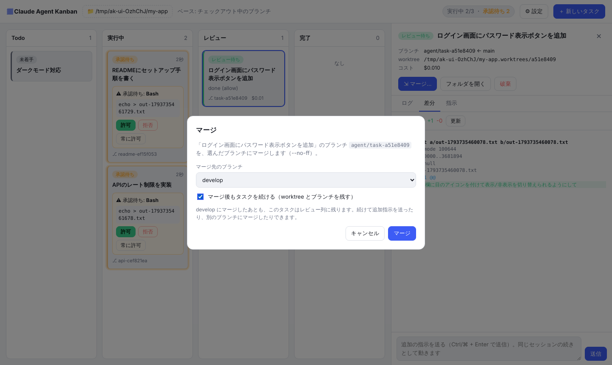

# 画面と使い方

それぞれの機能の、詳しい使い方です。エージェントの選び方と Pipeline・競争は [agents.md](agents.md)、設定の項目は [settings.md](settings.md) にあります。

## 複数のリポジトリをタブで行き来する
左上のリポジトリ欄はタブになっていて、リポジトリを **3つまで** 開いておけます。

- タブをクリックすると、そのリポジトリのボードに切り替わります
- 右の「＋」で、新しいタブにリポジトリを開きます（最近開いたもの・フォルダ・クローン・新規作成から選べます）。3つ開いているときは、タブを閉じてから開きます
- 今のタブをもう一度クリックすると、そのタブのリポジトリを別のものに置き換えられます
- タブの「×」で閉じます。閉じたり切り替えたりしても、そのリポジトリで動いているタスクは止まりません。ほかのタブには、動いているタスク（青）と対応を待っているタスク（黄）の数が出ます
- ベースブランチの設定はリポジトリごとに覚えておき、タブを切り替えると戻ります。開いていたタブは、次に起動したときも残っています

## カード上で承認する
承認待ちのカードは黄色く光ります。実行しようとしているコマンドを確かめて、その場で「許可 / 拒否 / 常に許可」を押せます。

## 詳細パネル（承認待ち）
カードをクリックすると開きます。入力の全文を確かめたり、拒否の理由を書いて Claude に伝えたりできます。ログはリアルタイムに流れます。

## 詳細パネル（差分・マージ）
レビュー列のカードでは、ベースブランチからの差分を見てからマージできます。マージ先は、好きなブランチを選べます（新しく作ることもできます）。

## エージェントからの質問に答える
選択肢の質問は、その場で選んで答えられます（複数選択・その他の自由入力にも対応）。

文章で質問されたときは「回答待ち」になり、下の欄から答えられます。

## 内容が詰まっていないタスクは、対話で仕様を詰める
新しいタスク（手で書いたもの・Issue から作ったもの）を始めると、エージェントはまず指示とリポジトリを読んで、開発を始められるくらい仕様が詰まっているかを判断します。

- 詰まっていれば、そのまま開発を始めます
- 詰まっていなければ、ファイルを変えずに止まり、カードが水色の「**仕様の確認**」になって「内容が詰まっていないので、開発を開始できません」と表示されます（🔔 とデスクトップ通知も出ます）。詳細画面にエージェントの質問が出るので、下の欄から答えます
- 答えるたびにエージェントがもう一度判断し、まだ足りなければ続きの質問をします。詰まったら「決まった仕様」をまとめてから、同じ会話の続きで開発を始めます
- 仕様の確認中は、Issue の Projects の Status をレビューにしません（In progress のまま）
- 設定の「新しいタスクの内容が詰まっていなければ、開発を始める前にエージェントと対話して仕様を詰める」で切れます

## スキルを選ぶ
「⚡ スキルを選ぶ」を押すと、使えるスキルがカードで並びます。1つだけ選べます。選んだスキルは、入力欄の上にラベルで出ます。

## 指示にファイルを添付する
「新しいタスク」と「会話」（始めるときと、続きのメッセージ）の入力欄には、画像・PDF・テキストなどのファイルを添付できます。

- 付け方は3つあります: 入力欄への **貼り付け**（⌘V / Ctrl+V。スクリーンショットもそのまま貼れます）、**ドラッグ＆ドロップ**、入力欄の下の「ファイルを添付」ボタン
- 付けたファイルは入力欄の下に並びます（× で外せます）。10 個まで、合わせて 20MB まで付けられます
- 添付は、作業フォルダ（worktree・リポジトリ）の外にあるアプリのフォルダに保存します。指示の最後には保存した場所を書き足すので、どのエージェントもそこから読めます
  - Claude Code には、画像（PNG / JPEG / GIF / WebP、3.5MB まで）をメッセージにそのまま付けて渡します
  - Codex / Gemini / Cursor と、画像以外のファイルは、保存した場所を見て読んでもらいます
- 遠隔操作のクライアントから付けたファイルは、ホストに送ってホストに保存します
- 付けた画像とファイルの名前は、ログの「あなたの指示」に出ます。タスクの最初の指示に付けたものは、「指示」タブにも出ます。タスクを破棄すると、添付も消します

## GitHub Issue から作成
「＋ 新しいタスク」を押し、上のタブで「GitHub Issue から作成」を選んで、Issue 番号と会話（セッション）を選びます。複数の番号を入れると、それぞれ1枚のカードになって並列で動きます。

## コンフリクトを解消する
マージでコンフリクトが起きたら、エージェントに解消してもらうか、自分で直すかを選べます。PR を作ったあとでマージ先が進んで PR がコンフリクトしたときも、同じようにアプリの中で解消して PR を更新できます。

## タスクを作らずにエージェントと話す（💬 会話）
上部の「💬 会話」を押すと、タスクに紐づかない会話を始められます（このリポジトリについての質問・調べもの・相談など）。話すエージェントは、使う設定のものから選べます。会話はボードの列には並ばず、「💬 会話」ボタンから一覧を開けます（ボタンの数字は会話の数。返事を待っている会話があると黄色で件数を出します）。会話を選ぶと画面の中央にモーダルで開き、下の欄から続きを話せます。

ログのエージェントの返事やあなたの指示は Markdown として整えて表示します（見出し・リスト・表・コードブロックなど）。

- worktree やブランチは作らず、リポジトリのフォルダでそのまま動きます。コミット・マージ・PR はしません
- 手元の作業中のファイルで動くので、ファイルの変更やコマンドは毎回カードで確かめます（設定の権限モードが「計画だけ」「すべて自動で許可」のときはそれに従います）
- 同時実行数の上限には数えないので、タスクが詰まっていてもすぐに返事が来ます
- 作業してほしくなったら「📝 タスクにする」を押すと、会話の続きとして worktree で動くタスクを作れます（会話そのものはそのまま残ります）。Claude Code どうしなら会話そのものを引き継ぎ、それ以外（Codex / Gemini / Cursor の会話や、別のエージェントのタスク）は会話のやりとりを最初の指示に添えて渡します

## 会話（セッション）を切り替える
詳細画面の「会話」で、次の実行にどの会話を使うかを選べます。既存の会話から引き継いだときは、どこから引き継いだかが表示されます。

## btw（実行中にメッセージを送る）
実行中のカードの「btw」タブから、作業を止めずに Claude へメッセージを送れます。受け取られると「反映済み」になります。

## マージ先を選ぶ
「マージ…」を押すと、マージ先のブランチを選べます。新しいブランチを作ったり、マージしたあともタスクを続けたりもできます。

## 直接マージか PR 作成かを選ぶ
設定の「レビュー後の取り込み方」で、**直接マージする**（ローカルで `git merge`）か **PR を作成する**（origin に push して `gh pr create`）かを選べます。PR にすると、レビュー中のカードのボタンが「PR を作成…」になり、base ブランチ・タイトル・本文を決めて PR を作れます（Issue から作ったタスクには `Closes #番号` が入ります）。追加指示で直したあとにもう一度押すと、同じ PR に push して更新します。PR の作成には gh のインストールとログインが必要です。

作った PR は、アプリが1分ごとに GitHub で状態を確かめます。**PR がマージされると、タスクは自動で「完了」になります**（worktree とローカルのブランチも片付けます）。ただし worktree に PR に入っていない変更（未コミットの変更や、push していないコミット）が残っているときは、消さずにレビュー中のまま残します。

## Issue のステータスを自動で変える
Issue から作ったタスクは、カードの列に合わせて、Issue が入っている **GitHub Projects の Status** を自動で変えます。

| カード | Status |
| --- | --- |
| 実行中・待機中 | In progress |
| レビュー（エラーを含む） | In review |
| マージして完了 | Done |

- PR を作ったとき（まだマージしていない）は In review のままです。PR がマージされたのをアプリが見つけると、タスクを完了にして Done にします
- Status の選択肢は、名前で探します（`In Progress` `🏗 In progress` `in-progress` `進行中` なども同じものとして扱います）。当てはまる選択肢がない Project は変えません
- 設定画面で、**変える項目の名前**（空なら `Status`）と、**列ごとに使う選択肢の名前**（例: レビュー → `QA`、完了 → `Released, Shipped`）を指定できます。指定した列はその名前の選択肢だけを使い、空の列はこれまでどおり名前から自動で探します
- gh に **project の権限** が必要です。設定画面の「Projects の権限を追加」を押すと、ブラウザで追加できます（ターミナルなら `gh auth refresh -h github.com -s project`）
- 設定の「Issue のステータスを自動で変える」で切ることもできます

## 通知（右上の 🔔）

承認待ち・質問・回答待ち・レビュー待ち・失敗・完了などの出来事は、右上のベルに貯まります（デスクトップ通知も出ます）。未読の数がベルに出て、通知を押すとそのタスクの詳細を開きます。「すべて既読」「すべて消す」もできます。

## 完了したあとも会話を続ける・スキルを提案してもらう
マージ（または PR 作成）して「完了」になったタスクにも、下の欄からメッセージを送って、そのタスクについて話せます（質問・調べもの・相談など）。タスクは **完了のまま** で、レビュー列には戻らず、マージのボタンも出ません。worktree は作り直さずにリポジトリのフォルダで、ファイルを変えない **計画モード** で答えます（タスクの指示とやりとりを渡して新しい会話で始め、2 回目からはその続きになります）。

修正が必要なときは、完了したタスクの「🛠 修正タスクを作る」から別のタスクを作ってください。元のタスクのやりとり（完了後の会話も含む）を引き継いだ新しいタスクになります。

タスクが「完了」に入ると、右上の 🔔 通知に「スキルにしませんか？」が届きます（設定でオフにできます）。通知の「💡 スキルを提案してもらう」を押すと、元のタスクのカードは使い回さずに、新しい会話のカード（「💡 スキルの提案: タスク名」）を作ります。元のタスクの指示・やりとり・結果をその会話に渡すので、元のタスクのエージェント（使わない設定なら、最初から選んでおくエージェント）がその作業を振り返って、スキル（`SKILL.md`）として残しておくとよいものを1〜3個提案し、「どれを追加しますか？」と聞いてきます。下の欄から答えると、そのままスキルを作ってくれます。

## できること

- **カードを作るとすぐに動き出す**: ブランチ `agent/<名前>-<id>` と worktree（`<リポジトリ>.worktrees/<id>`）を自動で作り、その中でエージェントの CLI（`claude -p` / `codex exec` / `gemini` / `cursor-agent -p`）を起動します
  - 設定の「ブランチの命名規則」に、`feature/<Issue番号>-<内容を表す短い英語> にする` のように自然言語で書いておくと、タスクの開始時にそのタスクのエージェントがその規則に従ってブランチ名を考えます（同じ名前がもうあれば `-2` などを付けます。決められなかったときはいつもの名前になります）
- **GitHub Issue からタスクを作る**: 「＋ 新しいタスク」で「GitHub Issue から作成」のタブを選び、番号を入れるだけで、Issue のタイトル・本文・ラベル・コメントからエージェントへの指示を作ります。`12, 15, 18` のように複数入れると、1つの Issue が1枚のカードになって並列で動きます
  - ブランチは `agent/issue-12-…`、コミットメッセージには `(#12)` が付きます。カードの `#12` を押すと Issue のページが開きます
  - 同じ画面で、会話（セッション）と追加の指示も選べます
  - Issue は **gh（GitHub CLI）** で読み込みます。gh が入っていなければ、同じ画面の「gh をインストールする」から入れられます（Mac は Homebrew、Windows は winget）。ログインしていなければ「GitHub にログイン」を押すと、ブラウザが開いて確認コードが表示されるので、それを入力するだけです
  - public リポジトリなら、gh がなくても読み込めます
- **エージェントからの質問に答える**:
  - 選択肢の質問（Claude Code の AskUserQuestion）が来ると、カードが紫の「質問」になり、回答フォームが出ます。1つ選ぶ質問はラジオボタン、複数選べる質問はチェックボックスで、どちらにも自由に書ける「その他」があります。1問だけの質問は、ボードのカードの上でボタンを押すだけで答えられます。「答えずに続ける」を押すと、Claude が妥当な方法で進めます
  - Claude が文章で質問して返事を終えたときは、カードが「回答待ち」になり、詳細画面に質問が表示されます。下の欄に答えを書くと、同じ会話の続きから進めます
  - どちらもデスクトップ通知が出ます。画面右上には「あなたの対応待ち」の数が出ます
- **スキルを選ぶ**: タスクを作るとき（手で書く / Issue から）と、詳細画面で追加指示を送るときに、Claude Code のスキルを1つ選べます。スキルはカードの一覧から選び、選んだスキルは入力欄の上にラベルで表示されます（× で外せます）
  - 選んだスキルは、指示の先頭に `/スキル名` として付けて Claude に渡します
  - 一覧には、このリポジトリの `.claude/skills/`、自分用の `~/.claude/skills/`、インストール済みのプラグインのスキルが出ます
  - ⚙ 設定で「新しいタスクで最初から選んでおくスキル」を決めておけます
- **会話（セッション）を選ぶ**: タスクを作るときに、過去の Claude Code の会話（ターミナルで話していたものなど）を選ぶと、その続きとしてタスクを始めます。元の会話はそのまま残ります（`--fork-session`）
  - 詳細画面の「会話」で、次の追加指示を「今の会話の続き」「新しい会話」「このカードの前の会話」「ほかの既存の会話」のどれで動かすか切り替えられます
- **会話（セッション）を消す**: 上部の「セッション」から、Claude Code の会話の記録を一覧して、選んで消せます（タスクとは関係なく消せます。「ほかのフォルダの会話も表示」でほかのリポジトリの会話も出せます）
  - 実行中・待機中のタスクが使っている会話は消せません。ほかのタスクが使っている会話を消すと、そのタスクは次から新しい会話で始めます
  - タスクをマージして完了にすると、そのタスクが作業に使った会話を自動で消します（引き継いだ元の会話と、完了後に話した会話は残します）。⚙ 設定の「マージして完了したら、そのタスクの作業に使った Claude Code の会話（セッション）を消す」でオフにできます
- **btw（実行中にメッセージを送る）**: 詳細パネルの「btw」タブから、エージェントの作業を止めずにメッセージを送れます（例:「テストも書いて」「その API は使わないで」）。Claude は作業の途中で読んで反映し、受け取ったら「反映済み」になります。待機中のタスクに送ると、開始するときの指示に付け足します
- **列は自動で移動**: Todo → 実行中（待機中を含む）→ レビュー（エラーを含む）→ 完了
- **カード上で承認**: 許可が必要な操作は、カードに「承認待ち」として表示されます。その場で **許可 / 拒否 / このタスクでは常に許可** を選べます。デスクトップ通知も出ます
- **詳細パネル**: カードをクリックすると開きます。左端をドラッグすると幅を変えられます（幅は覚えておきます。ダブルクリックで元の幅に戻ります）。中身は次のとおりです
  - ログ: エージェントの発言、ツールの呼び出しと結果がリアルタイムに流れます
  - worktree: worktree の作業状況。ベース → コミット → 未コミット（作業中）の流れ、触ったファイルの一覧（最後に編集した順・増減のバー）、ベースブランチがその後何コミット進んだか、同じリポジトリで並列に動いている worktree の一覧を表示します（実行中は自動で更新）
  - 差分: ベースブランチからの変更を、GitHub のようにファイルツリー（フォルダ）＋ファイルごとの差分（行番号つき）で表示
  - 指示: 最初の指示（開始前なら編集できます）
  - 追加指示: 同じセッションの続きとして動きます（`--resume`）
- **マージ / 破棄**: 好きなブランチにマージ（`--no-ff`）するか、worktree とブランチをまとめて削除します
  - マージ先は一覧から選ぶか、その場で新しいブランチを作れます（初期値はベースブランチ）
  - マージ先をどこにもチェックアウトしていなければ、一時的な worktree の中でマージするので、手元の作業フォルダは変わりません
  - 「マージ後もタスクを続ける」を選ぶと、worktree とブランチを残したままにします。たとえば `develop` に入れて確かめてから、あとで `main` にもマージできます
  - 「マージしたあと origin に push する」を選ぶと、origin の最新を取り込んでからマージして、`origin/<マージ先>` に push します（GitHub にも反映されます）。ローカルと origin が別々に進んでいるときは、壊さないように止めて知らせます。push の認証は、ふだんの git と同じ設定（キーチェーン・SSH など）を使います
  - 完了したタスクは削除できません（記録としてボードに残ります）
- **コンフリクトの解消**: マージでコンフリクトが起きると、カードが「コンフリクト」になり、コンフリクトしたファイルが表示されます
  - 「○○ に解消してもらう」: マージ先のブランチをタスクのブランチに取り込み、タスクのエージェントが両方の変更の意図を残して解消します
  - 「自分で解消する」: コンフリクトした状態の worktree を開くので、エディタで直して「解消した」を押します。「取り込みを中止」もできます
  - `<<<<<<<` などの印が残っているうちは完了にしません。解消できたら「もう一度マージ」を押すだけです
  - **PR のコンフリクト**: 作った PR を見張っているあいだに、GitHub で PR がマージ先とコンフリクトしていると分かったら、カードが「コンフリクト」になって通知します。上と同じく「○○ に解消してもらう」か「自分で解消する」を選ぶと、`origin/<マージ先>` をタスクのブランチに取り込んで解消します。解消できたら「PR を更新（push）」を押すと、PR のコンフリクトがなくなります。案内を閉じても、詳細の PR の行の「解消する」からもう一度始められます（PR を作って worktree を片付けたタスクは、GitHub 上で解消してください）
- **同時実行数の上限**: 上限を超えたカードは待機中になり、空きができると順番に起動します

## 注意

- マージ先のブランチをどこかでチェックアウトしている場合は、そのフォルダに未コミットの変更がない状態にしておいてください。コンフリクトしたらマージを中止して、そのことを知らせます
- 実行中・待機中のタスクがあるときにアプリを終了しようとすると、確認のダイアログが出ます。「中断して終了」を選ぶと、エージェントを止めてそれまでの変更をタスクのブランチにコミットしてから終了します
- 次に起動したとき、中断されたタスクには「中断」のバッジが付き、ボードの上に「▶ すべて再開」が出ます。タスクごとの「▶ 再開」でも、同じ会話の続きから作業を続けられます（待機中だったタスクは、その指示をそのまま渡し直します）。別の指示で続けたいときは追加指示を送ってください。アプリが落ちたときも同じように再開できます

---

[← README に戻る](../README.md)
